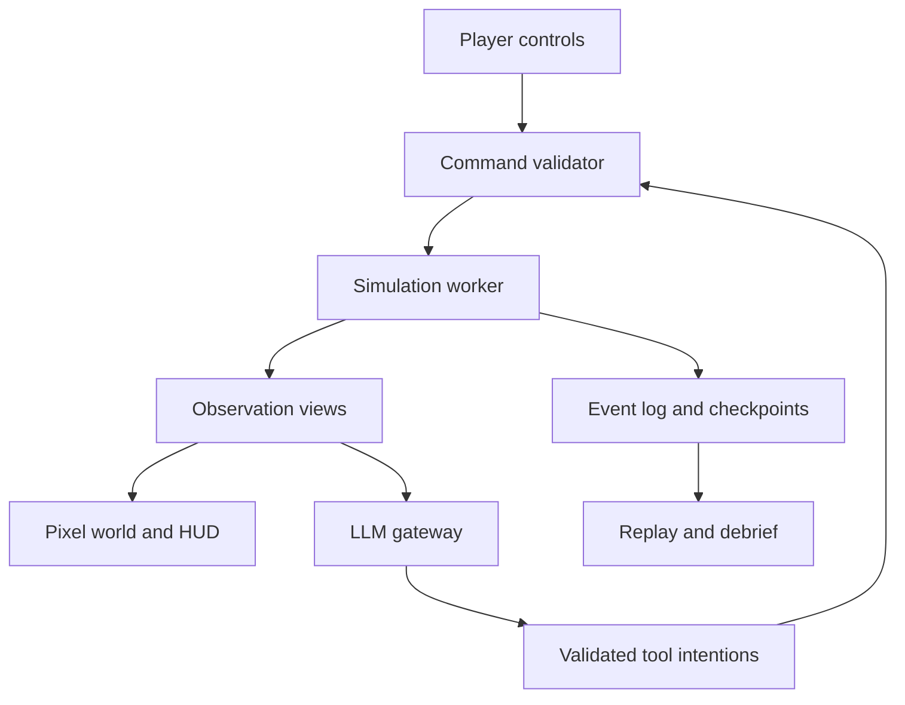
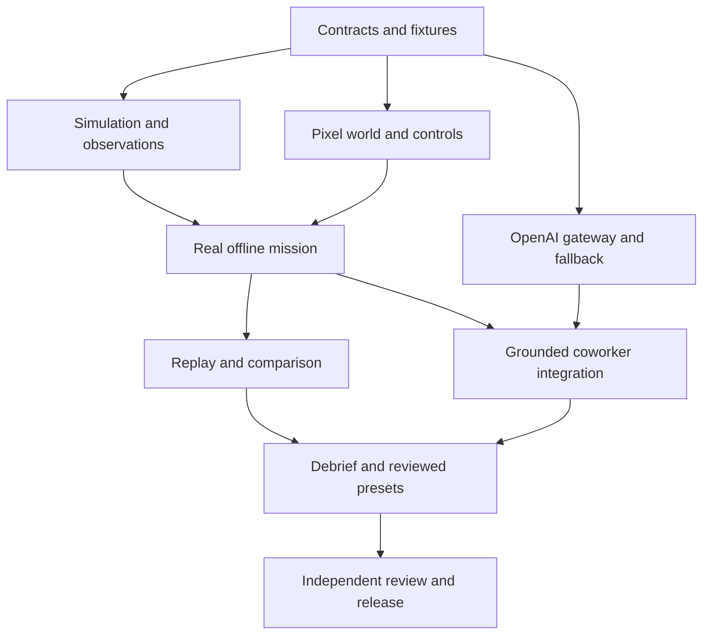

# Blackout Master Plan

> **For agentic workers:** Use `superpowers:subagent-driven-development` or `superpowers:executing-plans` when implementing this plan. The present deliverable is the product and implementation plan. The game has not been implemented by this document.

**Goal:** Build an educational incident-command game in which the player keeps a simulated data center operating through equipment failures, imperfect information, workload changes, and constrained maintenance resources.

**Architecture:** An authoritative deterministic TypeScript simulation runs in a Web Worker. A flat 2D pixel-art world and a readable React interface consume observation-based views of that simulation. A small local Node/TypeScript service calls OpenAI for grounded coworkers and debriefs through validated tools. A production demo serves the built browser client and API from one loopback origin on the presenter's laptop.

**Tech stack:** TypeScript, React, Phaser 4, Vite, a small TypeScript HTTP service, Zod schemas with compatible JSON Schema exports, browser IndexedDB, Vitest, and Playwright. Pin compatible versions from the official React TypeScript template during implementation. Keep OpenAI SDK details behind one adapter.

**Spec:** Sections 1–12 define the product, simulation, visual language, architecture, and release scope. Sections 13–17 define implementation packages, parallel-agent execution, verification, and the demonstration. Section 18 records confirmed decisions and the remaining uncertainties. Repository `AGENTS.md` is the short execution guide; this master plan remains the detailed source of requirements.

**Planning baseline:** Revised 7 November 2026 for one human builder assisted by one coordinating AI agent and at most three concurrent worker agents. There is no existing application. Build one complete Hot Restart mission first, then add reviewed presets within that family. Additional causal families are stretch scope. Timings, capacities, thresholds, performance budgets, and agent-duration estimates are design assumptions, not measurements of a real facility or completed application.

**Confirmed delivery decisions:** Solo human builder; new public repository; only the supplied challenge prompt and no existing code or approved facility material; OpenAI models available; low running cost with modest expansion if needed; a capable laptop; a judge-only local browser demonstration; and approval of the latest flat, visibly coarse pixel-art concept. Team-command controls, an overhead floor map, incident-response gameplay, new data-center staff as the primary audience, hackathon-first delivery, and coworkers plus debriefs remain confirmed. OpenAI API authentication and account credit are implementation checks, not yet verified access. This plan makes no NVIDIA-track eligibility claim.

**Two distinct meanings of agents:** Development agents implement and review the software in isolated worktrees. In-game coworkers are characters whose OpenAI responses use the game's scoped evidence and validated tools. Increasing the number of development agents does not add autonomous model calls to gameplay.

**Reading order for execution:** Start with [release scope](#12-release-scope-and-cut-order), [integration contracts](#103-frozen-integration-surface), [parallel-agent workflow](#14-solo-build-with-parallel-development-agents), and [remaining evidence checks](#18-uncertainty-audit-and-closure-register). The simulation details in Sections 3–8 and the art specification in Section 9 support those implementation decisions.

## Global constraints

- The confirmed art direction is **flat, overhead 2D with large, visible pixels**. The proposed implementation starts with a 16 × 16 tile grid and a 320 × 192 logical world viewport; verify readability with actual native-size assets. Earlier isometric concepts and their asset dimensions are superseded.
- The simulation owns physical state, task completion, timing, and scores. An LLM cannot assign temperatures, restore equipment, invent spare resources, or award points.
- Every consequential action has prerequisites, a duration, an equipment target, resource requirements, and explicit results.
- Truth, player observations, and each coworker's knowledge remain separate.
- Every shipped scenario has a known feasible response under its declared objectives. Damage-limitation scenarios must say that complete service preservation is impossible.
- The core mission remains playable when the model endpoint is slow, unavailable, or returns invalid output.
- API keys remain on the server. The first release has no live facility connections.
- Use high-level fictional maintenance actions. This is an educational systems model with disclosed assumptions; facility-calibrated prediction is a later capability.
- Prefer one complete, explainable incident over adding unfinished systems before the release gates pass.
- Run one coordinator and at most three workers. Assign exclusive writable paths, a pinned base commit, explicit contracts, and a concrete acceptance gate before dispatch. The coordinator owns integration and shared files.
- The public repository contains source, documentation, provenance, and synthetic fixtures. Credentials and local run data stay outside commits. A public repository does not require a publicly hosted game.

## Review focus

Review the units and accounting in the thermal and electrical models; algebraic dependencies between available power and cooling; simultaneous-event ordering; observations that could reveal hidden faults; delayed model responses after a reset; whether alternative replays preserve the same external disturbances; and whether low-resolution sprites remain recognizable at their actual runtime size.

## 1. Product definition

### 1.1 Player role

The player is the incident commander of a small data center during a difficult shift. They inspect equipment, interpret reports, choose service priorities, dispatch technicians, and decide which work can wait. The controls represent operational decisions rather than detailed real-world electrical procedures.

The mission has three service classes: a critical customer API, interactive workloads, and deferrable batch computation. Preserving one service can delay another. Paused batch work remains queued and appears in the outcome report; it does not disappear from accounting.

The central learning objective is to connect a decision with its consequences across multiple systems. Restoring power can leave cooling unavailable. Moving computation can overload the destination. A second power input can share a failed upstream component. A reassuring measurement can be old.

### 1.2 Why this fits the challenge

The supplied NMC² brief emphasizes missed warnings, unclear handoffs, and information arriving at the wrong time. Blackout turns those problems into observable, replayable decisions. Its strongest demonstration is a causal incident, a grounded coworker interaction, and a computed comparison of two responses.

Real outage reports support these mechanisms. Microsoft's Australia East report describes cooling failures following a voltage sag and a change from adjacent chiller recovery to recovery based on data-hall load. That is evidence for modeling restoration order and dependencies, not permission to claim a recreation of that facility. [S2]

### 1.3 Modes

| Mode | Purpose | Behavior |
|---|---|---|
| Guided mission | Teach a first-time player | Pause at initial teaching moments, explain terms inline, reveal progressively stronger hints. |
| Challenge mission | Apply the same principles independently | Limited information, no unsolicited solution hints, the same physical rules. |
| Replay and comparison | Explain consequences | Replay a saved run, inspect the decision timeline, and run one validated alternative. General scrubbing and arbitrary timeline editing are later features. |
| Sandbox, later | Explore systems | Choose bounded faults and loads, inspect assumptions, compare policies without a competitive score. |

Difficulty changes redundancy, workload, information delay, crew availability, and the combination of known fault mechanisms. It does not secretly change the laws of the model.

The release floor is the guided Hot Restart mission plus saved replay and its single comparison. A challenge preset can disable hints after that loop works. Sandbox controls, arbitrary timeline editing, and a separate campaign are not prerequisites for the first release.

## 2. The first complete mission

### 2.1 Facility

Build one compact site with eight racks in three labeled bays inside one hall. Add two aggregate cooling trains, two UPS units and distribution paths, a generator-backed cooling branch, two technicians, and a remote IT operator. The map can represent the generator as a connected yard panel if it does not fit the initial room.

The three bays are organizational and visual groupings. They are not three independent engineered data halls. Cooling allocation, airflow paths, and shared dependencies are explicit configuration data.

### 2.2 Flagship incident: Hot Restart

A short power disturbance ends. The racks remain powered through their UPS paths, but cooling fails to resume because a declared controller or circulation prerequisite is unavailable. Inlet-proxy temperatures rise, while the electricity dashboard appears mostly recovered.

The player can inspect the cooling state, dispatch a technician, reduce noncritical workload, check a second temperature source, and stage the eventual recovery. Repeatedly issuing restart commands does not bypass a missing prerequisite. A completed repair does not instantly remove stored heat.

Hot Restart must place critical, interactive, and deferrable work together on each endangered rack. Pausing unrelated batch racks does not reduce a critical rack's heat when the thermal nodes have no coupling and cooling is unavailable. The dedicated batch-rack placement in Last Feed is a separate scenario configuration. Validate the first mission's mitigation claim against its exact workload placement.

The first recovery lesson is verification before restoring workload. The current identical cooling trains and common capacity pool do not establish a meaningful load-aware chiller restoration order. A later scenario must add explicitly different loads or staggered readiness before claiming to teach that decision.

The opening mission uses a simple control or circulation fault. A water-temperature restart lockout belongs in a later scenario with an explicit water-loop state; the first model must not claim to simulate that mechanism using only room temperature.

### 2.3 Eight to twelve minutes of play

| Phase | Experience | What it teaches |
|---|---|---|
| Briefing, about 45 seconds | See the service objective, two crew members, and current equipment status. | Understand priorities before acting. |
| Initial disturbance, about 1 minute | Power returns but cooling output remains low. | Power availability and equipment readiness are different. |
| Diagnosis, about 2 minutes | Inspect trends and ask a coworker to check a prerequisite. | Separate evidence, inference, and missing information. |
| Intervention, about 3 minutes | Dispatch repair and choose a workload mitigation. | Repair time and thermal headroom create a real tradeoff. |
| Recovery, about 2 minutes | Restore cooling and manage a declared workload pulse. | Recovery needs sequencing and verification. |
| Debrief, about 2 minutes | Review the event chain and a simulated alternative. | Connect the decision to an operational principle. |

These are pacing targets. Default playback is 1× simulation speed. Offer pause and explicit 2× or 4× controls; display simulation time separately from wall time. The short judging demonstration can use a prepared checkpoint and faster playback.

### 2.4 Interaction loop

Select an asset, inspect its readings and timestamps, choose an intervention, select an eligible technician if required, review travel and work time, then dispatch. Show queued, traveling, inspecting, working, blocked, completed, and canceled states. A worker begins physical work only after arrival at the equipment's service tile.

Remote workload changes and field maintenance are different task types. A remote cap can take effect after its configured control delay; a physical repair consumes a technician and travel time. A canceled repair records any completed work and releases the worker according to that task's explicit cancellation rule.

### 2.5 Objectives and mission ending

Define the first mission's success in scenario data: the failed cooling prerequisite is restored; critical demand is fully served; no active overload remains; every modeled inlet proxy is below the profile's 27°C warning threshold; and batch processing has resumed at a sustainable rate. Hold those conditions for 60 simulated seconds and require a final fresh verification report before declaring success. The debrief still reports any earlier service loss and remaining batch delay.

Proposed failure conditions are 60 consecutive simulated seconds with no critical service, or failure to stabilize within a 600-second mission window. These are authored exercise limits, not real operational standards. Ending a mission stops new gameplay actions and closes pending model requests. Provide a clear result, debrief, retry, and checkpoint-retry path. Any continued practice occurs in an explicitly resumed practice branch.

The mandatory tutorial explains the first selection, timestamp check, inspection, and dispatch through short contextual prompts. Display objective progress throughout the mission. This authored first-time flow ships even if the adaptive LLM coach is cut.

Internal success evaluation can inspect truth, but live objective checkmarks and recovery countdowns must wait for permitted evidence. Show "awaiting verification" instead of disclosing a hidden correction. The initial verification rule uses authorized readings taken within 10 simulated seconds, with an independent probe required when the ordinary sensor is under investigation. Define separate objectives for the other families; Hot Restart's cooling-repair requirement does not apply to a sensor-only incident.

## 3. What realism means

Blackout has two initial fidelity levels: authored incident logic and reduced-order physical models. It models capacity, energy, heat accumulation, dependencies, delays, and information quality consistently. It does not initially calculate three-dimensional airflow, detailed battery chemistry, electrical waveforms, protective-device coordination, humidity, condensation, or real failure probabilities.

The distinction between a plausible model and a calibrated prediction must remain visible in the technical notes. Published thermal research uses lumped models alongside measured or CFD-derived information; those calibration inputs are absent from a hackathon prototype. [S4]

The player-facing interface should explain a relevant assumption when it affects a decision, such as "Estimated UPS runtime at current observed load." Keep the full assumptions in an accessible model-information panel and the debrief.

### 3.1 Authoritative clock and event order

Use a fixed step of **one simulated second**. Rendering and model requests do not advance the clock. Faster playback runs more of the same fixed steps; it does not enlarge the integration step.

Order scheduled events by simulation time, phase priority, then stable sequence number. At a tick boundary:

1. Apply due external disturbances and complete scheduled tasks in the documented order.
2. Validate queued player and NPC commands against the resulting state; reserve resources for accepted tasks.
3. Resolve electrical connectivity, source limits, transfer states, and equipment readiness.
4. Allocate served IT load and cooling electrical demand with explicit priorities and capacity limits.
5. Integrate battery energy and thermal state for the interval.
6. Apply resulting equipment protection transitions and recompute affected service status.
7. Sample sensors, deliver messages, update alarms, and publish actor-specific views.

Document which transitions take effect at the next boundary. If an energy source empties inside a tick, split or account for the partial powered interval; never grant a full extra second of energy. Use finite bounded resolution for capacity interactions rather than an unbounded solver loop.

Pause on browser visibility loss by default. On return, do not fast-forward through wall-clock time that was never simulated. Persist the checkpoint and event log before an intentional pause or reset where practical.

### 3.2 Thermal behavior

Give each rack-associated zone an effective temperature state. It is an **inlet-temperature proxy**, not a CFD prediction of every location in the room.

```text
C_i × dT_i/dt = Q_IT,i + Q_other,i
                 + sum(G_ij × (T_j - T_i)) - q_cool,i

q_cool,i = min(q_allocated,i, K_i × max(0, T_i - T_supply))
sum(q_allocated,i) <= available thermal cooling capacity
```

Use °C for temperature, kJ/K for effective heat capacity, kW for heat flow, kW/K for conductance, and seconds for time. Symmetric exchange between two zones must cancel in the combined energy balance.

The first cooling model uses a fixed 20°C cooling reference while the cooling train is ready. It does not calculate an actual supply-air temperature. When a required pump, controller, airflow path, or electrical supply is unavailable, that train's available output changes according to its modeled state. A later water-loop model can add finite coolant storage and temperature-dependent restart limits.

Cooling allocation uses declared zone connections. For the initial common-space model, calculate each zone's request `d_i = K_i × max(0, T_i - 20)`, then allocate `q_i = d_i × min(1, Q_available / sum(d))`. Set every `q_i` to zero when the request sum is zero. Do not let each rack independently claim the entire cooling unit's capacity. Passive building-envelope heat exchange is omitted from the short initial mission and must be disclosed in the model notes.

### 3.3 Demonstration parameters

The following constitute a fictional training profile selected for clear, testable behavior.

| Parameter | Initial value | Meaning |
|---|---:|---|
| Racks | 8 | Eight thermal zones and workload hosts. |
| Idle / peak rack power | 2 / 12 kW | Linear approximation within the ready state. |
| Baseline utilization | 0.6 | Gives 8 kW per rack and 64 kW total IT load. |
| Effective zone heat capacity | 200 kJ/K | Represents thermal inertia omitted from the simple model. |
| Cooling conductance per zone | 2 kW/K | Heat removal depends on the temperature difference. |
| Cooling reference temperature | 20°C | A model boundary, not a calculated supply-air measurement. |
| Initial neighbor conductance | 0 kW/K | Keep the first reference cases uncoupled; recalculate expected values before adding coupling. |
| Cooling trains | 2 × 80 kW thermal | Aggregate heat-removal capacities. |
| Simplified cooling COP | 3 | Thermal output divided by electrical input, before configured auxiliary demand. |
| UPS units | 2 × 5 kWh available stored DC energy | Energy above the modeled cutoff; each also has an independent 80 kW AC output limit. |
| Battery discharge efficiency | 0.95 | An illustrative conversion efficiency. |
| Generator capacity | 200 kW | Must cover all connected demand, including cooling and charging. |
| Generator start / transfer | 20 / 5 seconds | Authored delays, not specifications of real equipment. |
| Sensor interval | 5 simulated seconds | Separate from render and UI update frequency. |
| Normal sensor noise | Bounded ±0.2°C | Seeded observation variation. |

At baseline, one uncapped zone equilibrates at 20 + 8/2 = **24°C**. With all cooling removed, its initial temperature rise is 8/200 = **0.04°C per second**, or **3°C in 75 seconds**, before other modeled effects. Its uncapped cooling time constant is C/K = **100 seconds**. One 80 kW train can cover the 64 kW baseline heat load, but cannot cover an assumed 96 kW peak by itself.

These arithmetic checks are reference cases for the engine. They do not validate the chosen parameters against a real facility.

ASHRAE's recommended temperature envelope for classes A1–A4 is measured at the equipment inlet. Its 18–27°C recommendation is not a universal instantaneous shutdown threshold. [S3] Store warning, throttling, trip, dwell, hysteresis, and restart settings in a clearly labeled fictional equipment profile. A proposed gameplay profile can warn above 27°C, throttle after sustained exposure above 32°C, and shut down after sustained exposure above 40°C; these are game rules requiring tuning, not manufacturer limits.

Throttle reduces useful compute and changes power demand. Shutdown reduces heat production but does not reset the zone temperature. Restart requires both acceptable conditions and a boot delay.

Freeze the following first protection profile for integration tests, then tune only through a versioned scenario/profile change. These are fictional rules, not manufacturer specifications.

| State or transition | Initial rule |
|---|---|
| Ready | 100 normalized compute units per second; power follows executed work. |
| Monitoring warning | A reported temperature above 27°C creates an observed alarm. |
| Thermal throttle | True inlet proxy at or above 32°C for 30 continuous seconds reduces useful capacity to 50 units per second. |
| Throttle release | True inlet proxy at or below 30°C for 30 continuous seconds. |
| Thermal shutdown | True inlet proxy at or above 40°C for 10 continuous seconds; latch off. |
| Thermal restart | At or below 30°C for 30 seconds, valid power, and an accepted reset. |
| Off | Zero useful compute and zero rack power in this initial model. |
| Booting | 20 seconds at 4 kW with no useful compute, then the applicable ready or throttled state. |
| UPS output overload | Requested AC output above 80 kW trips that output at capacity resolution, with no unspecified overload allowance. |
| UPS reset | Qualified reset, healthy input, cleared fault, and declared post-boot demand at most 76 kW on the affected surviving path. |

Thermal protection uses the true proxy as an approximation of a separate protective measurement. A faulty monitoring sensor cannot directly trip a physically cool rack. When hosts are off, a declared out-of-band controller can store startup admission limits; it cannot execute workloads until hosts are powered and ready. This provides an explicit recovery path after overload rather than requiring powered hosts to lower the very demand that prevents their restart.

### 3.4 Power and stored energy

Use a capacity-and-connectivity graph for utility, generator, transfer switch, distribution branches, UPS units, rack inputs, and cooling supplies. A/B inputs only provide the redundancy supported by their actual graph. Declare shared upstream components explicitly.

```text
E_next = clamp(E + (eta_charge × P_charge
                    - P_discharge / eta_discharge) × dt / 3600,
               0, E_max)
```

Energy is in kWh; power is in kW. Charging and discharging are mutually exclusive. Power rating and stored energy are separate constraints. The 5 kWh figure is stored DC energy before discharge conversion losses, not usable AC output energy. This avoids counting the efficiency penalty twice.

At 32 kW per UPS, 5 kWh of stored DC energy and 95% efficiency give an ideal runtime of about **8.91 minutes**. A single UPS supporting 64 kW at that same initial energy gives about **4.45 minutes**. These figures apply while battery power is actually required. A failure of one UPS output while the other UPS still has utility input does not make the surviving UPS discharge its battery. The interface must revise the estimate when load changes and label it as a model estimate. Actual UPS runtime prediction needs device-specific information and calibration. [S5]

Cooling electrical demand is separate from thermal output. At the proposed COP, removing 60 kW of heat requires 20 kW of modeled cooling electricity before auxiliary loads. Count that demand against the actual cooling supply, not against the rack UPS unless the topology explicitly connects it there.

For the first mission, the topology is utility or generator to the ATS board, then separate branches to UPS inputs and cooling. UPS outputs supply IT only. The shared pump/controller belongs to the cooling branch. This permits powered racks and falling cooling output at the same time.

Use a proposed 2 kW standby allowance per enabled cooling train, including its allocated auxiliary demand, and 95% UPS conversion efficiency. The baseline source demand is about 67.4 kW for UPS inputs plus 25.3 kW for cooling, or 92.7 kW before charging. Cap recharge at 5 kW input per UPS. Do not add conversion losses to rack heat unless those losses physically belong in the modeled zone.

Resolve upstream allocation in a fixed order: IT conversion first, cooling second, charging last. Reserve cooling standby consumption, then bound thermal capacity by `COP × max(0, cooling_electrical_budget - standby_demand)`. Calculate heat removal using temperatures at the beginning of the segment. This removes a circular dependency between cooling demand and available power without an iterative algebraic solver.

An authored healthy sequence can start the generator by 20 seconds, finish transfer by 25 seconds, and finish a 30-second cooling restart at 55 seconds. At baseline, 55 seconds without cooling raises the modeled temperature from 24°C to 26.2°C. The flagship fault extends this ordinary delay. Show the difference between expected restart time and a failed prerequisite.

When a battery will empty within a tick, compute `t_empty = 3600 × eta_discharge × E / P_discharge`, integrate to that boundary, change the topology, recompute feed sharing, and integrate the remainder. A surviving UPS can empty sooner after receiving the other path's load, so recalculate its boundary after a feed loss.

Do not model every power shortage as graceful proportional supply. Equipment profiles define overload delay, trip, priority shedding, and restart behavior. Stage later boot loads so recovery can expose real capacity constraints.

### 3.5 Workloads and services

Approximate ready-state IT power as `P_idle + utilization × (P_peak - P_idle)`, with utilization bounded from zero to one. Use separate profiles for off, booting, throttled, and ready states.

Workload migration consumes time and declared network capacity. Destination demand and heat increase. Queue depth, dropped demand, delayed batch work, and useful delivered service remain separate quantities. Do not equate "all racks powered" with "all services healthy."

For the initial service model, one ready rack has 100 normalized compute units of capacity per simulated second. These are game units, not benchmarked hardware throughput. In Hot Restart, each rack initially receives 20 critical, 10 interactive, and 30 batch units per second, for utilization 0.6 and 8 kW. A deterministic scheduler serves critical work first, interactive work second, and batch work last. Pausing batch leaves 30 units per second and 5 kW while creating a batch backlog. Offered demand remains independent of admission caps, so reducing the cap cannot manufacture a perfect service-delivery score.

Conserve batch work as `next_backlog = previous_backlog + arrivals - completions - explicitly_logged_cancellations`. Instantaneous critical and interactive shortfall is recorded separately. Catch-up work after recovery consumes real spare capacity and can raise heat. Workload migration is outside the first release; pause, resume, and cap controls are sufficient for Hot Restart and the listed early extensions.

The initial action catalog has no batch-cancellation action, so the cancellation term is zero. In Hot Restart, resume batch with an initial catch-up ceiling of 50 units per second per rack. Together with 20 critical and 10 interactive units, that gives 80 executed units, 10 kW, and backlog drainage of 20 units per second per rack while capacity permits. The scheduler and protection limits still apply.

The first release can use service capacity and host availability. The next phase adds an explicit service dependency graph, network partitions, boot sequencing, and a three-replica database requiring two reachable replicas for writes. That quorum is the game's declared architecture, not a general rule for all databases.

### 3.6 People and tasks

Two field technicians have role qualifications, position, travel speed, a current task, and availability. The remote IT operator can handle workload tasks. Each worker has one active task. Shared task resources, such as a diagnostic tool, are explicit if used in a scenario.

Use the tile grid for navigation and a declared meter-per-tile scale for travel time. Personnel cannot walk through racks or repair from across the room. A path becoming blocked produces a visible blocked task or a deterministic reroute.

Start with one meter per tile and 1.25 meters per simulated second of walking speed. The task durations below are additional to travel and are authored pacing assumptions.

| Action | Actor | Work duration | Effect |
|---|---|---:|---|
| Inspect asset or take independent reading | Qualified field technician | 30 s | Produce a timestamped scoped observation. |
| Pause batch or change its ceiling | Remote IT operator | 3 s | Change admission while retaining backlog. |
| Restore cooling-control prerequisite | Facilities technician | 120 s | Requires inspection, clears the declared fault, then starts the 30 s cooling restart. |
| Clear airflow obstruction | Facilities technician | 60 s | Restore conductance without resetting temperature. |
| Replace monitoring probe | Facilities technician | 60 s | Restore reporting without changing physical temperature. |
| Reset tripped UPS output | Electrical technician | 20 s | Apply the reset conditions and downstream boot sequence. |
| Verify recovery | Remote IT operator | 10 s | Produce a report from current permitted readings and task results. |

Canceling an unfinished physical task releases the worker and produces no completed repair effect. Restarting the task requires its full work duration. Already completed observations remain available. This initial rule deliberately omits partial repair progress.

## 4. Observations, uncertainty, and communication

Maintain three layers:

| Layer | Contains | Who can use it |
|---|---|---|
| World truth | Actual energy, heat, connectivity, latent faults, pending failures, and equipment readiness. | Engine and post-mission forensic analysis. |
| Player observation view | Sensor samples, timestamps, delivered reports, visible indicators, and permitted topology. | HUD, world presentation, player-facing coach. |
| Actor knowledge view | Only observations and reports available to that coworker. | That coworker's model prompt and tools. |

Every observation has an ID, source, value, units, observation time, receipt time, and known freshness or quality metadata. Do not automatically mark a covertly faulty sensor as faulty. The player may need to compare it with an independent source.

The art also consumes an observation-based presentation view. A hidden fault must not appear as a red cabinet simply because the engine knows about it. A stopped, visible fan can be an observation. An invisible internal control failure cannot. The thermal overlay displays measured or explicitly estimated values; unknown cells remain unknown and stale readings are marked.

Handoffs contain affected assets, current status, supporting observations and their times, actions completed, work in progress, unresolved risks, next owner, and acknowledgment. The communication score concerns correct information and delivery, not eloquence or message count. HSE's handover guidance supports preparation, communication, and incoming cross-checking as distinct parts of the process. [S6]

## 5. Scenario variety

Use authored causal families with bounded, reproducible variation. A scenario is a structured specification, not a paragraph handed to the physics engine.

| Family | Mechanism | Decision or lesson | Release priority |
|---|---|---|---|
| Hot Restart | Power returns while a cooling prerequisite stays unavailable. | Diagnose readiness and buy repair time through workload control. | Required first mission. |
| Last Feed | One A/B path fails; the surviving path sees greater demand. | Manage capacity and stored energy without assuming redundancy is unlimited. | Stretch after the complete flagship and its reviewed presets. |
| False Signal | A stale or biased sensor resembles a local thermal problem. | Cross-check a report before sacrificing healthy service. | Stretch; choose one extra family if time permits. |
| Blocked Air | Local airflow conductance falls while plant output remains healthy. | Distinguish a local issue from a shared plant failure. | Paired extension of False Signal after both are validated. |
| Shared Dependency | A common circulation or controller component disables several cooling units. | Find the common dependency behind many symptoms. | First-family expansion. |
| Backup Refuses | Generator readiness is delayed or fails. | Reduce load before battery energy runs out. | Power expansion. |
| Demand Wave | Work arrives faster than available cooling can support. | Prioritize services and control demand. | Expansion. |
| Blind Room | Telemetry communication fails while equipment continues operating. | Work with stale information and restore observability. | Expansion. |
| Split Service | Powered hosts lose the modeled network quorum. | Separate facility recovery from application recovery. | Phase two. |
| Maintenance Window | Planned work removes redundancy before a second fault. | Recognize the actual remaining resilience. | Phase two. |
| Recovery Surge | Simultaneous boot and catch-up work exceed a surviving limit. | Stage recovery by capacity and service dependency. | Phase two. |
| Hot Loop | Coolant temperature blocks a restart. | Manage thermal storage and restoration order. | After a water-loop model exists. |

The first variety target is three reviewed Hot Restart presets: a guided baseline, a delayed-report or crew-position variation, and a higher-load recovery variation. Vary only parameters supported by the existing model and verify each response window. Shipping one validated preset is preferable to labeling untested combinations playable. An additional causal family is stretch scope. Before exposing broad generation, create and validate at least three presets for that family. Add an information or handoff modifier only when the resulting combination still has a verified response.

A seed generates a mission once before play. It does not introduce new unscheduled catastrophes because the player is doing well. Adaptive difficulty belongs between missions. Scenario difficulty and scoring assumptions are recorded with the run.

For Last Feed, start with 64 kW of IT demand and fail one UPS output while the surviving input remains energized. Introduce an announced 60-second ramp toward 96 kW. The surviving 80 kW limit creates a real decision window. In the declared workload placement, two racks host deferrable batch work; pausing their peak jobs reduces those racks from 12 to 2 kW each and leaves 76 kW total. Use a hard capacity/protection rule for the initial profile, with no undocumented overload grace period.

Its separate placement gives six service racks 20 critical and 40 interactive units per second, and two batch racks 60 batch units each. During the pulse, interactive demand rises to 80 on each service rack and batch demand to 100 on each batch rack. A provisional schedule ramps up from t = 60 to 120 seconds, holds through t = 240, then returns to baseline by t = 300. The finite pulse permits sustainable batch recovery; validate this exact schedule before shipping the preset.

Use family-specific completion conditions. Last Feed can finish with the lost path unavailable if critical service is stable, the surviving path remains within capacity, batch processing becomes sustainable after the pulse, and degraded redundancy is explicitly reported. False Signal requires an independent discrepancy check, correction of the reporting fault, and trustworthy current evidence. Blocked Air requires restored conductance and verified thermal recovery. All families report earlier service loss and batch delay rather than erasing them on success.

For the third family, use two distinct hidden causes behind a similar warning. With neighbor coupling zero, an airflow obstruction can reduce one rack's conductance from 2 to 0.8 kW/K, giving a 30°C equilibrium at 8 kW and a gradual rise from 24°C. The first sensor-only preset leaves the real rack at 24°C but adds a positive reporting bias. An optional freeze preset must begin from a declared elevated sample and preserve its original observation time; freezing an ordinary 24°C report would not create the promised overheating warning. An independent probe distinguishes the causes. Clearing an obstruction changes conductance; replacing a sensor changes observations. Neither action overwrites temperature.

Validation includes schema checks, referenced entity checks, power and cooling feasibility, reachable service tiles, task prerequisites, resource sufficiency, and a known successful policy. A hand-authored policy is sufficient for the first presets; do not build a general planner merely to validate the hackathon version.

## 6. LLM design

### 6.1 Role allocation

| Role | Input | Permitted output | Priority |
|---|---|---|---|
| Field coworker | Role-scoped observations, task results, procedures, delivered messages. | Grounded reports, hypotheses, inspection requests, proposed allowed tasks. | P0. |
| Debrief writer | Engine-generated decision ledger and computed comparison results. | Explanation with evidence references. | P0. |
| Radio and handoff presentation | Structured factual event payloads. | Concise character-specific messages containing those facts. | P0 with templates; optional model phrasing within the same budget. |
| Adaptive coach | Player-visible evidence and objective progress. | Progressive hints without hidden answers. | P1. |
| Scenario author | Approved templates, bounded parameters, schema, design objectives. | Proposed specification for validation before a run. | P1, offline or pre-mission. |

One model adapter can serve these roles. Separate role prompts and knowledge projections are more important than running many autonomous services.

### 6.2 Coworkers

Use three recognizable characters: a facilities technician who inspects cooling, an electrical technician who reports power-path readiness, and a remote IT operator who handles workload priorities. Give them concise communication styles, not random personalities that manufacture mistakes.

A useful response structure is `observation`, `evidenceIds`, `inference`, `uncertainty`, and `proposedActions`. The coworker can say what remains unverified. Numeric readings, repair ETAs, and asset states must refer to available observations or engine results.

A valid evidence ID alone does not prove that the accompanying sentence agrees with the evidence. Return factual references as structured record-and-field selectors, and render readings, units, task status, and ETAs directly from those permitted records. Compose factual radio lines from templates and those fields. Display model-written interpretation separately as an inference. The same rule applies to debrief metrics: the engine supplies the values and factual timeline; model prose is an explanatory layer, not an authoritative numerical source.

When uncertain, the model can request an inspection. An inspection advances through the ordinary task system and produces a new observation on completion. It cannot return the hidden answer immediately.

### 6.3 Tool boundary and example

The allowlist starts with `get_observations`, `read_procedure`, `inspect_task_status`, `request_inspection`, and `propose_action`. Keep tool names and argument schemas fixed. `request_inspection` requires the appropriate delegated scope and an eligible worker; plant-changing proposals use the player's ordinary action confirmation.

Every tool result, action receipt, validation failure, fallback, and event reference passes through the same role-scoped projection. Keep internal diagnostic reasons and hidden causal-parent events in the engine log. A public rejection can state that an inspection is required; it must not reveal an unobserved component fault merely because a speculative action was rejected. Procedure access is based on known assets and role, not an undisclosed diagnosis. `propose_action` is not a hidden-state query API.

Example: the player asks the facilities technician to investigate Cooling-2. The initial context already includes that actor's recent permitted readings and the relevant short fictional procedure. The model requests a local inspection, receives the engine's acceptance and ETA, and returns a grounded acknowledgment. A later completion event supplies the inspection result in a new interaction. The read tools obtain missing permitted context when needed; the ordinary path does not spend three calls fetching data before it can dispatch.

The worker is in the browser. The server returns tool intentions to the client; the client executes approved tools through the worker and sends scoped results to the next model turn. The server must not pretend it can directly read browser-worker memory.

An accepted inspection returns a public task receipt, task ID, and ETA immediately. End that request normally. A terminal task event can start a new bounded model turn with the actor's delivered result and a fresh scoped view. Do not keep an HTTP request open for a multi-minute repair or inspection. The tool-turn limit applies to each bounded interaction, not the entire lifetime of the physical task.

Use OpenAI's Responses API. Declare the allowlisted function tools with `strict: true`, `additionalProperties: false` on each object, and all properties required; use nullable fields where an argument can be absent. Set `parallel_tool_calls: false`. Preserve the returned output items, then append the matching `function_call_output` by `call_id` when continuing the tool cycle. [S8]

Use `text.format` with a strict JSON schema for the final coworker response and debrief. Check refusals and incomplete responses before parsing. Schema adherence is a shape guarantee; the game still validates evidence, role, freshness, and action prerequisites. [S9] Keep SDK and provider encoding inside `server/llm/adapter.ts`; share domain schemas with the client instead of provider SDK objects.

### 6.4 Validation and failure behavior

Validate syntax, schema, permitted tool name, target existence, role, bounds, prerequisites, available resources, and relevant entity versions. Model text cannot write arbitrary state fields. Evidence IDs must belong to the actor's view. A model saying "repair complete" does not complete the repair.

Every model request carries `runId`, `requestId`, the knowledge snapshot hash, and relevant observed entity versions. Discard replies from a previous run or reset. A late factual report can remain visible with its observation timestamp. Revalidate an action against current conditions before execution; do not reject every reply simply because a global revision advanced while the model was responding.

Make command application idempotent by request and tool-call ID: a duplicate returns its original receipt without reserving resources twice. A reset creates a new run instance even if the seed stays the same. Timeout and cancellation close the originating request; a late response cannot execute tools. Match every resumed tool result to its run, request, actor, and call ID. Cache keys include the run, actor, knowledge hash, prompt version, and model identity.

Use one active provider request globally for this single-player local demo, one active interaction per conversation, and coalesce related events. Cap an interaction at three model calls, including the final response. Force a final response without further tools on the last permitted call; if no valid final response arrives, render the permitted receipt and authored fallback. The 2–5 second short-response target remains unmeasured. Initial deadlines are 8 seconds per coworker provider call, 18 seconds for a complete coworker interaction, and 20 seconds for the single debrief call. Disable automatic SDK retries so hidden retries cannot evade the limits. Do not pause the simulation merely because a network request is outstanding.

On failure, display an authored response assembled from the same permitted observations. Mark scripted fallback and cached demonstrations honestly. Limit calls by meaningful events and explicit player interactions, not per frame or per tick. An interaction can contain multiple billable provider calls. Start with a server-enforced ceiling of 24 provider invocations per mission, counting tool rounds, completion messages, debrief, and any explicit retry. Also enforce a persistent local session allowance independent of client-created run IDs and server restarts. Exhausting an allowance invokes authored fallback. No ongoing public inference or paid hosting is part of this plan.

Bound context using the current permitted observations, relevant procedures, pending tasks, and a short recent conversation window. Measure actual request sizes and usage before estimating cost. Set supported provider parameters explicitly rather than inheriting expensive or incompatible defaults. Logs should normally contain request IDs, duration, usage, status, and validation outcomes rather than raw prompts.

Treat free-form player messages and scenario prose as data. They cannot expand the tool allowlist, access another actor's hidden observations, or change the rules. The browser has no provider secret. Add payload limits, timeouts, and rate limits to the server before sharing the demo.

### 6.5 OpenAI model, configuration, and cost

The initial candidate is `gpt-5.6-luna` for both coworker dialogue and the debrief, with `reasoning.effort: "none"`. Current official documentation describes a cost-sensitive model and lists Responses, function calling, and Structured Outputs support. Published text rates are $0.20 per million input tokens, $0.02 per million cached input tokens, and $1.20 per million output tokens; cache writes are listed at 1.25 times the ordinary input rate. Account access, quality on these tasks, and measured latency remain unverified. [S13]

| Setting | Initial implementation value |
|---|---|
| Provider and endpoint | OpenAI, `https://api.openai.com/v1`, Responses API. |
| Coworker and debrief model | `gpt-5.6-luna`; record the actual returned identity in provenance. |
| Reasoning | Explicit `none`, subject to the selected model's documented support. |
| Storage parameter | `store: false`; maintain only the bounded local interaction state needed for continuation. |
| Input allowance | At most 6,000 planned tokens including instructions, schemas, history, observations, and results. |
| Output allowance | 400 tokens per coworker call; 800 per debrief call. |
| Application default | `LLM_MODE=scripted`; switch the local config to `live` after the readiness check. |
| Proposed application API allowance | $5 for development/rehearsal/demo, enforced by the local gateway; an explicit configuration change can raise it. |

The $5 figure is a conservative configurable default chosen to interpret "keep it light," not a purchase, a provider-side billing cap, or permission to charge an account during planning. No paid request was made while preparing this plan. Development-assistant subscriptions/usage and image generation have separate costs and are not included in the per-mission estimate.

At 24 calls, 6,000 input tokens per call, and the larger 800-output-token cap on every call, the planning envelope is 144,000 input and 19,200 output tokens. At ordinary uncached rates this computes to $0.05184 per mission. Conservatively pricing every input token at the documented cache-write rate gives $0.05904, approximately **$0.06 per mission or $3 for 50 missions** under those assumptions. Actual usage, price changes, account-specific terms, and other tools can change the bill. Do not assume cache discounts or enable billable hosted tools. [S13]

Before each attempt, reserve the maximum planned token cost against the local allowance. Reconcile reported usage afterward; retain a conservative reservation for a canceled request with unknown usage. Validate/truncate input before sending, include tool schemas in the estimate, and reject a request that exceeds the allowance. Cache factual responses only within the correct run/actor/view identity. A user resetting a mission must not reset the global allowance.

The readiness check is one authenticated structured response and one actual inspection tool round trip through the worker, followed by ten representative interactions measuring full rendered-response latency and usage. Verify the exact account's model access and limits. OpenAI access stated by the user does not itself establish API credentials or available credit; ChatGPT and API billing are separate. [S14] Configure credentials through the local environment, never through the public repository or a chat transcript. If this candidate is unavailable, keep the scripted path working while selecting another documented low-cost OpenAI model and updating the price table explicitly.

## 7. Educational feedback and scoring

Give every mission two or three explicit learning objectives. The first mission teaches that electrical recovery does not imply cooling recovery, that mitigation can buy repair time, and that restoration requires verification. NIST's exercise guidance supports objectives, scenario development, conduct, evaluation, and an after-action process. It does not establish that Blackout has already proven learning effectiveness. [S7]

Score from engine-observable behavior, with separate categories:

| Category | Evidence |
|---|---|
| Service preservation | Delivered critical demand, unmet-demand minutes, and delayed batch work. |
| Diagnosis | Appropriate cross-checks and identification supported by the available evidence. |
| Operational discipline | Required prerequisites, qualified task assignment, and staged restoration. |
| Communication | Correct facts, timestamps, next owner, and acknowledgment. |
| Recovery | Time to verified stable operation and unnecessary intervention cost. |

Keep unsafe or invalid operational choices separate from speed. A weighted total must not let a fast but disallowed strategy dominate a valid response. Accept multiple effective strategies. Do not penalize a player for information they could not have known.

The first release provides practice feedback through separate outcome categories, with no weighted overall proficiency grade. A structured diagnosis or handoff can record the selected cause, supporting observations, unresolved risk, and next owner when that skill is a mission objective. Merely clicking an inspection button is not evidence of understanding. Browser-local simulation supports practice and reproducible feedback, not tamper-resistant examination scores or secrecy against a player inspecting their own browser.

The debrief follows: **available evidence → decision → consequence → feasible alternative → principle**. Include a small chart of temperature and delivered service with action markers. Every numerical outcome is generated by the engine. The LLM explains the ledger rather than estimating missing results.

A short second incident with the same principle and different observations can later test transfer. No practitioner or novice reviewer is currently available. For the hackathon, report only usability checks actually performed and distinguish a self-rehearsal from an independent novice session. Practitioner validation and learning-effectiveness studies are later work, not a release gate the solo builder can claim to have met without participants.

## 8. Replay and computed alternatives

Persist explicit simulation engine and schema versions, scenario content identity, procedure content identity, seed, initial configuration, accepted and rejected commands, external event schedule, observations, realized dialogue, tool results, and checkpoints. LLM provider/model identity and prompt versions are provenance. Keep the same simulation engine and content versions when replaying a saved run; provider availability is not a replay dependency.

A checkpoint includes physical state, travel progress, scheduled task completions, future external events, delayed observations, resource reservations, actor knowledge, protection timers, and deterministic random state or draw keys. Normalize these authoritative fields and event order for replay hashes; exclude renderer positions, wall time, and transport-only IDs. Assign commands an engine tick and stable sequence number; incidental Promise completion order must not determine event priority. Replay displays the recorded dialogue and tool receipts without querying the model again.

A single RNG seed is insufficient if different branches consume random draws in different orders. Pre-sample external disturbances or use stable event/entity/time keys. Recompute endogenous cascades from the alternative state; do not force the original failures to happen when the alternative prevents them.

The first comparison should be narrow and valid: apply a noncritical workload cap earlier while retaining every other originally accepted domain action at its recorded simulation time, including workload changes, inspections, switching, and repair requests. Originally rejected attempts remain visible in the audit log but are omitted from this initial continuation policy; state that limitation in the comparison description. Both branches use the same initial state, external workload pulse, sensor-noise schedule, and duration.

Record domain action intent separately from its live transport and concurrency envelope. Reissue the retained intent into the branch with a new run ID, branch-local request IDs and idempotency receipts, current relevant versions, and mappings for referenced task IDs. Then validate actual domain and knowledge prerequisites. An original run ID or revision mismatch is not evidence that the alternative is physically infeasible.

If moving an existing cap earlier, remove its original scheduled instance. Compare equal simulation horizons. Label the result as "Earlier batch cap, with the same subsequent accepted commands and external disturbances." It does not claim to predict which decisions the player would have made after seeing different observations.

Use the baseline record's final simulated time as the comparison horizon. If the alternative reaches a terminal mission objective earlier, the comparison driver still advances its physical model to that horizon without inventing actions or making model calls. The interactive result screen may pause its own clock driver; it must not cause the comparison to freeze temperatures or backlog at the earlier ending. Retained commands still undergo the ordinary terminal-state and prerequisite checks, so an invalid later command makes that continuation unsupported.

If the altered action makes later recorded commands invalid, stop the automatic branch at the first unsupported command. Do not silently skip, retarget, reschedule, or invent a continuation. Withhold full-horizon outcome claims and either label the common-prefix result or let the player continue interactively. More general alternative policies can be added later with their continuation rules stated explicitly.

For coaching, the alternative must be feasible with information the player had at that decision. The forensic view can reveal hidden truth after the mission, but must distinguish hindsight from an available choice.

## 9. Flat 2D pixel-art specification

### 9.1 Committed visual identity

Use an orthogonal top-down map, horizontal and vertical walls, chunky square pixels, compact equipment silhouettes, and limited shading. The cyberpunk character comes from dark industrial rooms, cyan indicator pixels, restrained purple trim, amber work lights, and character portraits.

The latest generated flat, coarse-pixel direction board is the approved visual reference. Approval settles the direction; it does not establish a finished tile atlas, a playable interface, or exact native-grid consistency. Produce actual game assets on the declared grid and inspect them at runtime scale. Do not reopen the earlier isometric direction.

### 9.2 Pixel rules

| Rule | Specification |
|---|---|
| Logical viewport | 320 × 192 pixels, equivalent to 20 × 12 floor tiles. |
| Tile grid | 16 × 16 pixels, orthogonal. |
| Desktop scale | 3× gives 960 × 576; 4× gives 1280 × 768 when the layout fits. |
| Palette | 24–32 world colors, about three shades per material. |
| Sampling | Nearest neighbor; disable smoothing for world textures. |
| Coordinates | Continuous simulation positions; integer-snapped render and camera positions. |
| Zoom | Discrete integer scales; preserve aspect ratio and center spare space. |
| World text | Minimal short labels; detailed values and explanations live in the DOM. |
| Effects | Pixel frames and grid-aligned shapes; restrained animation driven by observed state. |

Integer scaling and explicit image-rendering behavior preserve hard pixel edges. Verify browser zoom and device-pixel-ratio behavior on the actual demo display rather than assuming CSS alone guarantees consistent pixels. [S11]

### 9.3 Palette and interface

Start with navy `#07111B`, panel blue `#102332`, light text `#DCEAF2`, muted text `#92A8B7`, cyan `#45D5E8`, purple `#CA70EA`, amber `#F4B860`, and critical red `#F06B79`. These are proposed anchors; derive the restricted sprite palette from them and verify final contrast.

The top bar shows delivered service, hottest observed inlet temperature with freshness, power headroom, and simulation time. The right panel shows the selected asset's observations, trend, dependencies, recent events, and actions. The bottom strip shows crew assignments and progress. Show one map overlay at a time: temperature, power, or service dependencies.

Use ordinary readable UI fonts for dense information. A blocky pixel heading can establish the theme without forcing a novice to read an explanation through a tiny pixel font.

### 9.4 Asset manifest

Dimensions are native logical pixels. Anchors are measured from the untrimmed frame's top-left. Preserve source dimensions and atlas metadata.

| Priority | Asset family | Frame | Anchor | Initial content |
|---|---|---:|---:|---|
| P0 | Floor | 16 × 16 | 8,8 | One base; two variants after the core gate. |
| P0 | Walls and corners | 16 × 16 | 8,8 | Horizontal, vertical, corners, doorway. |
| P0 | Rack | 16 × 32 | 8,16 | One recognizable base; separate status pixels; extra appearances later. |
| P0 | Cooling train | 32 × 32 | 16,16 | One base, four fan frames. |
| P0 | UPS | 16 × 32 | 8,16 | One base, charge/discharge/off overlays. |
| P0 | Distribution cabinet | 16 × 16 | 8,8 | One base, observed-state indicator. |
| P0 | Technician | 12 × 16 | 6,8 | Four directions, one idle and two walk frames each. |
| P1 | Technician work | 12 × 16 | 6,8 | Two work frames per direction; a readable static work state is sufficient initially. |
| P1 | Tool cart | 16 × 16 | 8,8 | One base. |
| P1 | Portrait | 32 × 32 | Center | Three characters; text identity works before portrait polish. |
| P0 | Path, selection, flow, heat | Grid primitives | Grid | Drawn from view state. |
| P1 | Generator | 32 × 32 | 16,16 | Standby/running frames. |
| P1 | Network cabinet | 16 × 16 | 8,8 | Base and observed link-state pixels. |
| P1 | Signs and props | 8 × 8 or 16 × 16 | Center | Small shared set. |

The polished target is roughly 15–20 approved base tiles and objects, 20 technician frames, four cooling frames, and three portraits. It is not the first-release asset floor. Start with the floor/wall set, rack, technician, and cooling masters; use simple grid-aligned symbols for power cabinets and state overlays until their final sprites exist. Reuse animation geometry with character color variants. A 512 × 512 RGBA atlas has a 1 MiB uncompressed base level and is a reasonable ceiling. Use padding to prevent adjacent sprite bleed.

### 9.5 Asset production and animation

First approve a rack, floor tile, technician, and cooling-unit reference at the exact intended native sizes. Generate modular transparent bases against the same reference, view, light direction, silhouette rules, and palette. Normalize every accepted base to its declared native frame size, restrict its palette, clean the pixel clusters and transparency, and align its anchor and collision footprint. Inspect the result at native size and at 3×. Review each sprite for recognizable equipment shape. Inspect every frame of a generated sheet; do not assume frame counts or alignment are correct.

The game/UI worker owns the first four master assets and their runtime integration in Wave 1. Verify them before producing variants. Timebox the first asset pass to 90 minutes; if it slips, cut extra cabinet appearances, directional work-frame polish, and portrait variants first. Preserve the floor, rack, cooling unit, technician, and essential state indicators. A later art-polish task can use a freed worker slot, with exclusive ownership of the asset directory for that task.

Keep labels, status indicators, paths, and progress graphics separate from base artwork. Name assets by role and state, for example `rack_standard`, `cooling_fan_0`, and `tech_walk_n_1`, and record frame duration, anchor, collision footprint, and license/provenance in the manifest.

Use sprite frames at approximately 4–8 frames per second for fans and walking. Rendering can still run at 60 frames per second. The engine's task progress determines location; animation merely depicts it. Pause freezes mission animation, and speed changes advance it consistently with simulation time.

| Visual behavior | Required cause |
|---|---|
| Fan spins or stops | Observed operating state. |
| Rack indicator activity | Observed power and workload state. |
| Technician walks | An accepted task and a valid route. |
| Work loop plays | Worker has arrived and the task is progressing. |
| Flow pixels move | A known active power or cooling path. |
| Migration progress appears | An actual migration task is pending. |
| Temperature overlay changes | A new measurement or explicitly labeled estimate. |

Use PNG sprite atlases in the game. Export GIF or video loops for the submission and promotional previews. Engine-controlled frames let pause, speed, state transitions, and reduced-motion settings stay coordinated; independent looping GIF elements would need additional synchronization. MDN documents the relevant image-format properties. [S12]

Do not add smoke, sparks, or arcing to ordinary temperature warnings. Those effects imply damage mechanisms the initial simulation does not contain.

## 10. Architecture and contracts

Phaser owns the scene, camera, sprite animation, input hit areas, and technician presentation. React owns the HUD, charts, equipment list, accessible controls, conversations, and debrief. The official React TypeScript template provides a React–Phaser bridge and currently identifies Phaser 4 in its README; its older repository description still says Phaser 3. Pin the actual compatible dependency set at kickoff. [S10]



The local service exposes a small bounded OpenAI endpoint and serves the production client from the same origin. No vector database, account system, multiplayer server, cloud host, or live equipment connector is needed in the first release. Store local runs in IndexedDB and allow JSON export. Use static, versioned procedure excerpts keyed by asset and task before adding retrieval infrastructure.

### 10.1 Shared data boundaries

| Contract | Key fields | Owner |
|---|---|---|
| `ScenarioSpec` | Versions, template, seed, topology, equipment profile, external events, fault presets, objectives. | Content validator. |
| `TruthState` | Run, revision, simulation time, physical state, tasks, latent faults. | Engine only. |
| `Observation` | ID, source, value, units, observed and received times, known quality. | Observation system. |
| `KnowledgeView` | Actor, accessible observations, delivered messages, allowed procedures, view hash. | Projection layer. |
| `ActionIntent` | Actor, domain action, stable target, bounded args, intended simulation time; independent of transport IDs. | Recorded command stream and branch replay. |
| `ActionRequest` | Request/run IDs, action intent, relevant expected versions, idempotency key. | Validated command path. |
| `PublicToolResult` | Status, public reason code, allowed evidence, task receipt/ETA, matching call and actor IDs. | Role-scoped projection; internal diagnostics excluded. |
| `SimEvent` | ID, time, type, affected entities, causal parents, visibility, payload. | Append-only event log. |
| `AgentResponse` | Request/run IDs, speaker, observed versions, factual field references, labeled inference, tool intentions. | Gateway plus validators. |
| `Checkpoint` | Physical state, tasks/travel, reservations, events, delayed deliveries, knowledge, protection timers, draw state. | Engine snapshot/restore. |
| `RunRecord` | Engine/schema/scenario/procedure identities, model/prompt provenance, seed, external schedule, inputs, events, dialogue, checkpoints. | Persistence. |

Expose a small engine API: `initialize`, `step`, `applyCommand`, `observe`, `snapshot`, and `restore`. The engine imports no React, Phaser, DOM, network, or provider code. It receives deterministic randomness and scenario data through explicit inputs.

### 10.2 Proposed repository layout

These paths are the intended layout for a new repository; they do not describe files already implemented.

```text
src/shared/           contracts.ts, schemas.ts, units.ts, fixtures.ts
src/sim/              engine.ts, clock.ts, events.ts, rng.ts
src/sim/systems/      power.ts, thermal.ts, workload.ts, crew.ts, observations.ts
src/sim/replay/       recorder.ts, checkpoints.ts, ledger.ts, comparison.ts
src/workers/          simulation.worker.ts, protocol.ts
src/game/             FacilityScene.ts, sprites.ts, paths.ts, overlays.ts
src/ui/               hud/, inspector/, crew/, radio/, debrief/
src/llm/              client.ts, tool-runner.ts, fallback.ts
src/content/          equipment/, topologies/, scenarios/, procedures/
src/persistence/      runs.ts
server/               index.ts, config.ts, llm/adapter.ts, llm/prompts.ts, llm/validation.ts, llm/budget.ts
public/assets/        world.png, world.json, portraits.png, manifest.json
tests/contracts/      shared fixture and protocol compatibility
tests/sim/            reference cases and scenario policies
tests/llm/            invalid, stale, and knowledge-boundary cases
tests/replay/         checkpoint, replay, and comparison cases
tests/e2e/            mission.spec.ts, fallback.spec.ts
docs/                 blackout-master-plan.md, build-status.md, task-packet-template.md,
                      asset-provenance.md, model-assumptions.md, demo-script.md, handoffs/, reviews/
AGENTS.md             short development-agent execution guide
.env.example          nonsecret local configuration defaults
```

### 10.3 Frozen integration surface

The coordinator owns contract version `1` and publishes the types, Zod runtime schemas, JSON examples, and adapter stubs before workers start. Interfaces below are the required public boundaries; implementation internals remain owned by their worker. Use stable string IDs and finite serialized numbers, explicit units, and simulation seconds. Wall-clock milliseconds belong only in transport/latency fields.

| Boundary | Required interface | Behavioral contract |
|---|---|---|
| Engine creation | `initialize(spec: ScenarioSpec, runId: string): SimulationEngine` | Creates a balanced, seeded state; performs no network or rendering work. |
| Fixed advancement | `engine.step(ticks: number): StepResult` | Advances an integer number of one-second ticks using the same event order at every playback speed. |
| Commands | `engine.applyCommand(request: ActionRequest): CommandReceipt` | Queues intent with a stable sequence and idempotency key; distinguishes queued from accepted/rejected/applied. Execution is resolved at the documented command boundary. |
| Projection | `engine.observe(actorId: string): KnowledgeView` | Returns permitted evidence, public task receipts, action affordances, and observed versions; excludes latent faults and hidden causal parents. |
| Checkpoint | `engine.snapshot(): Checkpoint` and `restore(checkpoint: Checkpoint, runId: string): SimulationEngine` | Restores all authoritative timers, pending work, knowledge, and RNG/event state; a new run envelope invalidates old provider callbacks. |
| Browser bridge | `SimulationClient.command`, `observe`, `subscribe`, `pause`, `setSpeed`, `snapshot`, `restore` | Typed request IDs and a single worker protocol; UI never reaches into worker memory. |
| UI root | `OperationalView({ view, onAction, onInspect, onAskCoworker })` | Reads one projected view and emits typed intentions. Visual state is not authoritative simulation state. |
| Gateway client | `startInteraction(input, signal)` and `continueInteraction(input, signal)` | Returns a discriminated union: scoped tool request, validated final response, or explicit fallback. |
| Tool runner | `executeToolIntent(intent, scopedContext): Promise<PublicToolResult>` | Uses the same worker validation path and role projection as direct player actions. |
| Outcomes | `buildOutcomeLedger(record): OutcomeLedger` | Computes numerical outcomes and factual timeline from the engine record; makes no model call. |
| Comparison | `compareEarlierCap(record, change): ComparisonResult` | Uses the recorded external schedule; returns completed or unsupported continuation with the valid common horizon. |

The engine may receive commands while paused, but processing them must not advance physical time. At an explicit command boundary, reserve accepted work and return its receipt; travel, work duration, and heat resume only when time advances. Record that boundary's sequence so replay does not depend on Promise timing. A queued receipt is never presented as a completed inspection or accepted repair before the relevant validation occurs.

Freeze these minimum payloads in the schema pack:

| Payload | Fields required before fan-out |
|---|---|
| `KnowledgeView` | `schemaVersion`, `runId`, `actorId`, `simTime`, `viewHash`, permitted observations, known topology, public task summaries, allowed procedure IDs, action affordances, observed entity versions. |
| `ActionRequest` | `schemaVersion`, `runId`, `requestId`, `actorId`, `intent`, `expectedEntityVersions`, `idempotencyKey`. The worker assigns its simulation sequence. |
| `CommandReceipt` | Matching IDs, status, public reason code, permitted task ID/ETA or evidence references, and applicable observation time. Hidden diagnostics stay internal. |
| `GatewayStart` | Run/request/actor IDs, role, bounded user message or trigger, scoped `KnowledgeView`, permitted procedure excerpts, prompt version. |
| `GatewayContinue` | Matching run/request/interaction/actor IDs, expected call ID, current scoped view, validated public tool result. Provider history stays bounded and server-owned. |
| `AgentResponse` | Matching IDs, speaker, factual field selectors, clearly labeled inference/uncertainty, permitted action proposals, and mode (`live`, `scripted`, or `recorded`). |
| `OutcomeLedger` | Record/version identity, equal-horizon times, critical/interactive delivery and shortfall, batch backlog/delay, thermal and protection events, action/evidence timeline. |
| `ComparisonResult` | Base/branch identity, continuation policy, shared external-schedule identity, completion/unsupported status, supported horizon, outcome ledgers when valid, and public explanation of limitations. |

Freeze the worker request/reply discriminated unions as part of G0, not merely the names of domain types. Requests cover `initialize`, `advance`, `command`, `observe`, `snapshot`, and `restore`; replies cover initialized/advanced acknowledgments, command receipts, projected views, recorder-only checkpoints, and bounded errors. Every request/reply carries its correlation ID and run identity, with the explicit new-run identity on restore. The coordinator's protocol fixtures cover each variant, including stale-run rejection.

Freeze gateway responses with a `kind` discriminator for `tool_request`, `final`, and `fallback`, separate from the displayed `live`/`scripted`/`recorded` mode. The UI props and typed intent callbacks in this section are part of the same contract version. No worker supplies an alternate envelope to avoid an integration dependency.

A checkpoint can contain authoritative state for restoration, but it is restricted to the recorder/replay path. Do not pass it through normal React view props or the coworker gateway. `ComparisonResult` must distinguish `complete` from `unsupported`; the unsupported variant includes the first invalid retained action and valid-prefix evidence, and excludes full-horizon alternative metrics. A UI must not render an unsupported branch as a completed comparison.

The gateway can reject malformed or excessive payloads, but it does not become a second source of physical truth. A local-browser training game does not claim server-verified anti-cheat. Distinguish API response shape validation from the engine's domain validation and the UI's evidence rendering.

`GET /api/health` reports mode, configured model, and whether a key is configured, without revealing the key or making a paid probe. `POST /api/llm/turn` accepts the start/continuation union. Abort/reset closes the matching interaction, and any delayed reply must still fail the run/request check. Keep the first protocol ordinary JSON over local HTTP; streaming and WebSockets are not required.

### 10.4 Local demo packaging

The production service binds to `127.0.0.1`, serves the built client and `/api` routes from one origin, and calls OpenAI over HTTPS only in live mode. The development command may use a Vite proxy, but rehearsal uses the production build. Vendor fonts, sprites, procedures, scenario data, and fallback text locally so networking can be disabled without breaking the mission.

The foundation task must provide these scripts. Their appearance in this document does not mean they already exist or passed.

| Command | Required purpose |
|---|---|
| `npm ci` | Install the committed dependency set on the demo laptop. |
| `npm run dev` | Start the development client and local gateway with one command. |
| `npm run typecheck` | Check browser, worker, shared, and server boundaries. |
| `npm run test:sim` | Reference cases, task/observation invariants, and authored mission policies. |
| `npm run test:llm` | Tool contracts, evidence boundaries, stale/canceled responses, quotas, and fallback with mocked provider transport. |
| `npm run test:replay` | Checkpoint identity, deterministic replay, and valid/unsupported comparisons. |
| `npm run test:e2e` | Integrated production mission and provider-failure flows. |
| `npm run build` | Build the browser bundle and local server artifacts. |
| `npm run demo` | Serve the production client and gateway at `http://127.0.0.1:4173`. |
| `npm run verify` | Run typecheck, focused test suites, production build, and the required end-to-end gates. |

The demo must have a visible mode indicator, a prepared checkpoint, clean reset, pause/speed controls, and a saved local run. Port `4173` is the proposed stable production origin; keep it stable because browser persistence is origin-specific. Fail clearly if it is occupied instead of silently choosing another port and appearing to lose saves.

Store `OPENAI_API_KEY` only in the server process environment or an ignored local configuration file. Never prefix it with `VITE_`. Commit a blank-key `.env.example`, not real credentials. Enforce local Host/Origin checks, JSON payload limits, deadlines, and usage bounds. Keep local allowance data and diagnostic logs under ignored `.local/` paths. The public repository and the judge-only local app are separate delivery choices.

## 11. Performance and accessibility

Proposed performance gates: immediate input acknowledgment under 100 ms; 60 FPS on the demo laptop with a 30 FPS fallback; no main-thread stalls during a comparison; and an initial download under 5 MB excluding optional later content. Measure these after integration.

A one-second simulation step does not require one-second animation jumps. Interpolate technician presentation between known positions and round the rendered pixel coordinates. Sensor sampling remains five seconds unless the profile says otherwise. Do not invent fresh readings just to animate a chart smoothly.

Provide a keyboard-accessible equipment list, visible focus, textual states, and sufficient text contrast. A selectable object has at least a 16 × 16 logical hit area, which becomes 48 × 48 CSS pixels at 3×. On narrower displays, collapse the inspector into a drawer.

Honor reduced motion. Replace moving flow markers and decorative cycles with static state symbols and readable progress. Keep alarms understandable without sound or blinking. Show audio events as captions. Default to restrained effects so the game remains legible during a stressful incident.

## 12. Release scope and cut order

| Mandatory first release | Finish only after the required gates pass | Later |
|---|---|---|
| One compact room, eight racks, two technicians, and coherent coarse pixel art. | Three reviewed Hot Restart presets. | Multiple rooms and a campaign. |
| One complete cooling incident with briefing, intervention, recovery/failure, and retry. | One additional causal family, selected for remaining time. | A full incident library. |
| Thermal, power-capacity, workload, crew, and observation basics. | Extra state animations, portrait expressions, and sound polish. | Water-loop storage, network/quorum behavior, and restoration surges. |
| One live grounded coworker inspection tool cycle; three character roles share the same adapter. | A second live conversational role or a more nuanced handoff. | Adaptive coaching and validated scenario authoring. |
| Engine-generated outcome ledger with factual timeline and concise OpenAI explanation. | More explanatory detail and a novice playtest. | Instructor tools and measured learning studies. |
| Replay, checkpoint restore, and one valid computed earlier-cap comparison. | Extra alternatives if their continuation policies are valid. | General policy comparison. |
| Local laptop launch, bounded API cost, labeled model fallback, accessible essential controls. | Wider browser/device checks. | Public hosting, shared sessions, and facility integrations. |

Cut in this order: additional causal families; adaptive coach and scenario author; cosmetic variants and audio; secondary overlays; extra comparison options. Preserve the approved pixel direction, one complete causal mission, evidence-grounded coworker, outcome ledger, and the single valid comparison. A failed comparison is shown as unsupported rather than replaced with invented metrics. If the mandatory loop cannot pass before freeze, disclose the missing feature and ship the last working checkpoint; do not describe a partial release as meeting this plan's full acceptance definition.

Baseline accessibility, truthful fallback labeling, accounting correctness, and secret handling are release requirements. They are not polish to defer. Voice, dynamic image generation during play, multiplayer, procedural facility layouts, login, cloud hosting, and a vector database remain outside the initial scope.

## 13. Implementation work packages

### Task 1: Freeze contracts and create the application shell

**Files:** `src/shared/*`, `src/workers/protocol.ts`, application entry points, `server/index.ts`, package scripts.

**Owner and dependency:** Coordinator, task `CORE-00`, before fan-out. The server file is only a shell/route contract at this stage and transfers to the OpenAI worker before Wave 1. The coordinator retains all root dependency and configuration files.

- [ ] Pin the official template's compatible dependencies and commit the lockfile.
- [ ] Define units, action types, scenario schema, observation schema, event visibility, and run identifiers.
- [ ] Establish a typed worker request/response bridge and a separate model gateway.
- [ ] Render a placeholder tile map and DOM inspector from a mock `KnowledgeView`.
- [ ] Verify a production build and a worker request round trip before parallel integration.

**Gate:** Every workstream can compile against the shared contracts. No component depends on private fields from another subsystem.

### Task 2: Build the headless model and analytic reference cases

**Files:** `src/sim/*`, `src/sim/systems/power.ts`, `thermal.ts`, `workload.ts`, `tests/sim/*`.

**Owner and dependency:** Simulation worker, `SIM-01`, after G0. Deliver reference cases as a small first commit before adding the whole mission lifecycle.

- [ ] Implement stable event ordering and fixed-step advancement.
- [ ] Implement power connectivity, capacity, UPS energy, and readiness states.
- [ ] Implement heat balance, bounded cooling allocation, workload power, and protection dwell/hysteresis.
- [ ] Implement the fictional equipment profile and an initial balanced state.
- [ ] Verify the analytic equilibrium, cooling-loss slope, recovery curve, UPS runtime, and capacity bounds.
- [ ] Compare a ten-minute reference trace with a half-sized timestep; choose a documented tolerance, initially 0.1°C for the thermal trace.

**Gate:** The headless reference cases pass before any animation is treated as evidence of correctness.

### Task 3: Add crews, observations, and the first incident

**Files:** `crew.ts`, `observations.ts`, `src/content/*`, scenario policy tests.

**Owner and dependency:** Simulation worker owns `SIM-02` engine behavior and tests; coordinator owns `CONTENT-01` topology, profiles, procedures, and scenario files. These are separate path leases. Begin against G0 fixtures, integrate after `SIM-01`, and validate the actual scenario before G1.

- [ ] Create the walkable map, service tiles, travel time, qualifications, and task lifecycle.
- [ ] Implement delayed and noisy observations separately from truth.
- [ ] Author Hot Restart with a known successful response and a plausible unsuccessful response.
- [ ] Implement the explicit success/failure rules, 60-second recovery hold, 600-second mission window, and final verification requirement.
- [ ] Add workload mitigation, cooling inspection, repair, and restoration actions.
- [ ] Verify that the mission can be completed with its supplied crew and resource budget.

**Gate:** One headless mission shows a full causal chain and distinguishable outcomes for meaningful choices.

### Task 4: Build the pixel world and operational UI

**Files:** `src/game/*`, `src/ui/*`, `public/assets/*`.

**Owner and dependency:** Game/UI worker. `UI-01` uses frozen fixtures in parallel with `SIM-01` and `AI-01`; `UI-02` consumes the integrated `SIM-02` worker to reach G1. It does not wait for G1 to start. The coordinator owns the host application entry and worker bridge, so the UI worker exports the agreed component and callbacks.

- [ ] Produce, normalize, and inspect the master tile, rack, cooling, and technician sprites at native size and 3×, including palette, alpha, anchors, and footprints.
- [ ] Add orthogonal placement, integer scaling, selection, keyboard list, and state-linked animation.
- [ ] Connect the actual `KnowledgeView`, actions, crew queue, and trends.
- [ ] Add observed thermal and power overlays with stale and unknown states.
- [ ] Add the authored first-inspection/dispatch guidance, objective progress, result screen, and retry path.
- [ ] Verify the entire first mission without a model connection.

**Gate:** A player can diagnose, act, and recover using the controls, while visuals reflect only permitted observations.

### Task 5: Integrate the bounded coworker

**Files:** `server/llm/*`, `src/llm/*`, `tests/llm/*`; radio presentation is a separate UI-owned change in `src/ui/radio/*`.

**Owner and dependency:** OpenAI worker. `AI-01` builds the adapter and fallback against mocks after G0. `AI-02` completes a real worker tool cycle after G1, with `UI-02` consuming the shared response schema. No second command executor or private UI schema is permitted.

- [ ] Verify tools, schema support, authentication, and latency against the selected endpoint.
- [ ] Add the role-specific knowledge projection and tool allowlist.
- [ ] Project every tool result and rejection through that role; render factual fields from records rather than trusting prose with valid-looking evidence IDs.
- [ ] Complete one actual inspection tool cycle through the worker and back to the model.
- [ ] Add evidence links, timeouts, cancellation, reset handling, and deterministic fallback text.
- [ ] Test wrong asset IDs, unknown tools, invalid evidence IDs, stale actions, and requests to reveal hidden faults.

**Gate:** A model response cannot mutate truth outside the shared action path, and an outage does not prevent mission completion.

### Task 6: Record, explain, and compare

**Files:** `src/sim/replay/*`, `src/persistence/runs.ts`, `src/ui/debrief/*`.

**Owner and dependency:** After G1, the coordinator transfers `src/sim/replay/**`, `src/persistence/**`, and `tests/replay/**` to `REPLAY-01`. The UI worker retains debrief components in `UI-03`; the OpenAI worker retains the explanatory prompt in `AI-03`. Each consumes the same ledger and comparison contracts. These are coordinated tasks, not overlapping permission to edit all listed files.

- [ ] Record the initial specification, event schedule, action log, observation history, and realized model interaction.
- [ ] Verify deterministic replay using normalized state hashes.
- [ ] Restore protection timers, travel, reservations, delayed reports, and actor knowledge; replay recorded dialogue without a provider request.
- [ ] Add one validated earlier-workload-cap alternative from a checkpoint.
- [ ] Compute both outcome ledgers; reject unsupported continuations explicitly.
- [ ] Reissue branch action intent with branch-local transport metadata and task references, retaining the documented continuation policy.
- [ ] Render the chart and causal timeline before adding the LLM's grounded explanation.
- [ ] Save and reload one local run across a browser refresh.

**Gate:** The explanation's numbers and causal references agree with the recorded simulation, and both comparison branches use the same external conditions.

### Task 7: Add reviewed variety and finish the demonstration

**Files:** scenario presets, end-to-end tests, model notes, demo script.

**Owner and dependency:** Coordinator owns `CONTENT-02` and `RELEASE-01` after G2. Reuse freed worker slots for a bounded read-only review or an explicitly transferred preset-validation task. Optional variety is never a dependency of the required release.

- [ ] If time permits, add two additional reviewed Hot Restart presets after the flagship passes. Admit at most one additional causal family only after all required release gates are secure.
- [ ] Run the successful and failure policies for every shipped preset.
- [ ] Check native pixel scale, interaction targets, small-screen layout, and reduced motion.
- [ ] Run the full demo with live model, slow model, and disconnected model conditions.
- [ ] Export a clearly labeled fallback recording and the model-assumptions notes.

**Gate:** The final artifact has a repeatable demonstration, no hidden dependency on a live model response, and no unfinished controls exposed as working features.

## 14. Solo build with parallel development agents

### 14.1 Capacity and decision ownership

There is one human builder. Use one coordinating agent and at most three active workers across the entire agent tree. A reviewer or an art specialist uses a freed worker slot; it is not an extra fifth agent. The coordinator remains responsible for the critical path, shared decisions, integration, validation evidence, and the release. The human handles account access, the actual laptop rehearsal, and the judging presentation. Routine reversible implementation choices do not require a new approval round.

Parallelism shortens independent implementation work. It does not multiply human review capacity, eliminate integration time, or guarantee four times the throughput. Stop spawning workers when the coordinator cannot review their output promptly.

| Role or later assignment | Deliverable | Exclusive writable paths |
|---|---|---|
| Coordinator/integrator | Contracts, fixture pack, application shell, worker bridge, scenario content, integration, and release evidence. | Package/lock/config files; `src/main.tsx`; `src/App.tsx`; global styles; `src/shared/**`; `src/workers/**`; `src/content/**`; `tests/contracts/**`; `tests/fixtures/**`; `tests/e2e/**`; global docs. |
| Simulation worker | Deterministic headless model, task system, observations, and mission outcomes. | `src/sim/**`, `tests/sim/**`. |
| Game/UI worker | Coarse-pixel map, normalized atlas, selection/dispatch controls, radio presentation, and debrief UI. | `src/game/**`, `src/ui/**`, component-scoped styles, `public/assets/**`, `tests/ui/**`. |
| OpenAI worker | Local server, bounded tool loop, client adapter, factual-response validation, usage limits, and fallback. | `server/**`, `src/llm/**`, `tests/llm/**`. |
| Replay assignment in Wave 2, reusing slot 1 | Checkpoint persistence, outcome ledger, and earlier-cap comparison. | `src/sim/replay/**`, `src/persistence/**`, `tests/replay/**`, after the prior owner stops writing and the coordinator records the transfer. |

Every worker may also write its uniquely assigned `docs/handoffs/<task-id>.md`. No worker edits the lockfile, shared schemas, global CSS, another role's components, or the integration branch. A specialist can inherit a subset of paths in a later wave only after the previous owner has stopped editing and the transfer is recorded.

### 14.2 Repository and branch policy

Start a new public repository named `blackout`, using a clearly identified available alternative if that name is occupied. The repository seed includes the README, this master plan, `AGENTS.md`, task-packet template, build-status table, provenance notes, and ignore rules. Do not describe the documentation seed as a playable game. Keep public hosting outside the initial scope.

The coordinator creates an integration branch and one isolated worktree per active task, for example `agent/sim-w1`, `agent/ui-w1`, and `agent/openai-w1`. Start them from the same pinned foundation commit. The packet records the actual commit SHA and worktree path, not a moving branch name. Workers make small commits and return their hashes; they do not merge, force-push, switch the shared checkout, or publish the application.

The coordinator reviews changed paths and integrates one task's commits at a time. A shared-contract change is its own reviewed coordinator commit. Notify affected workers and rebase them at a safe checkpoint. Do not resolve a contract disagreement by maintaining incompatible local interface copies.

If isolated worktrees are unavailable, exclusive path ownership in a shared checkout is the fallback. Disable worker git mutations in that mode; only the coordinator stages or commits. This avoids one worker changing the checkout beneath another. Keep a rollback point at every passing integration gate.

### 14.3 Foundation before fan-out

Spend the first 45–60 productive minutes on the shared foundation. This is a target, not a guarantee. The coordinator pins the template and dependencies, adds the planned scripts, establishes the React/Phaser host and worker bridge, and freezes the first contract version in Section 10.3.

Publish five small fixtures: an observed cooling alarm with no diagnosis, a dispatched inspection with ETA, a completed inspection with permitted evidence, a model-fallback response, and an outcome ledger with one comparison. Fixtures must be schema-valid, versioned, and visibly designated as development fixtures. Mock data is not evidence that a mission works.

**Gate G0:** The production shell builds; a typed worker round trip succeeds; every worker can import the same schemas; the mock view renders; and package scripts exist. Start the three implementation workers after G0. The OpenAI account check can happen alongside foundation work if a slot is available, but it cannot edit shared package files independently.

### 14.4 Dependency waves



| Wave | Coordinator | Worker slot 1 | Worker slot 2 | Worker slot 3 | Exit gate |
|---|---|---|---|---|---|
| 0: foundation | Contracts, scripts, fixtures, worker bridge, initial content. | Optional bounded account/capability spike. | Idle until a truly independent task exists. | Idle. | G0: common shell and protocol compile. |
| 1: independent build | Author topology, fictional procedures, objective rules, and acceptance policies; integrate small completed parts. | Engine, power/heat/workload, crew, observations, snapshot fields. | Four master assets, map, inspector, controls, radio/debrief layouts against fixtures. | OpenAI adapter, gateway, tool schemas, client adapter, fallback, quota and race tests against mock tool results. | G1: real offline Hot Restart completes and fails correctly; G1-L: gateway contract and fallback pass. |
| 2: connect the differentiators | Real worker/action wiring, full tool round trip, cross-system tests, evidence-ledger review. | Replay/checkpoints/earlier-cap comparison after explicit transfer of replay/persistence paths. | Live map/radio/debrief integration and native-pixel verification. | Live coworker and debrief, latency measurement, invalid-output/reset/timeout handling. | G2: deterministic replay, valid comparison, grounded live tool execution, complete provider-disconnected mission. |
| 3: review and finish | Resolve defects; preserve passing build; package and rehearse through `RELEASE-01`. | Independent simulation/replay review, using a different agent from its implementer. | Interface/knowledge-boundary review or essential art fixes, with nonoverlapping ownership. | Gateway review or scoped preset validation, with nonoverlapping ownership. | G3 is produced by release verification and laptop rehearsal, after the review; it is not a prerequisite for starting packaging. |

Do not start replay implementation before the snapshot contract and mission state have stabilized. Do not let the UI worker consume `TruthState` to avoid waiting for the observation projection. Do not let the OpenAI worker invent a second action executor. The coordinator resolves those dependencies through the shared adapter.

### 14.5 Work packets and completion contract

Each dispatch includes a task ID, one concrete output, pinned base commit, contract version, relevant plan sections, inputs/fixtures, writable paths, read-only dependencies, explicit exclusions, acceptance checks, timebox, and handoff format. Use `docs/task-packet-template.md`. A useful task is one independently testable part, not an instruction to build an entire subsystem without an integration checkpoint.

For example, `SIM-01` produces the fixed-step heat/power/workload reference cases in its owned paths. It does not edit the UI, content schema, or server. `UI-01` makes the observed alarm and task-receipt fixtures usable at native pixel scale. `AI-01` returns a validated inspection intent and handles a scoped mock receipt without changing engine state itself. Later packets replace mocks with real dependencies.

Every handoff states: base commit; produced commits; files changed; contract assumptions; commands actually run and their results; trace/screenshot/tool-receipt evidence; known limitations; and ready-for-integration or blocked status. A worker's own passing checks are evidence for review, not permission to self-approve a merge.

Keep `docs/build-status.md` coordinator-owned. Track `queued`, `active`, `blocked`, `ready for review`, `changes requested`, and `integrated`, with the commit and gate evidence. Missing evidence prevents a task from being marked integrated.

### 14.6 Integration and review procedure

For each patch, check ownership and scope first, then review against the specification. Integrate the smallest coherent commit, run its focused tests and typecheck, and exercise the shared fixture or real workflow it affects. Re-run broader checks only when the changed dependency or release gate requires them. Fix a failing integration before layering unrelated work on top of it.

Use a fresh reviewer for high-risk engine, observation, replay, and model-boundary changes. The reviewer reads the relevant implementation and identifies concrete violations, reproduction steps, and severity. The original implementer fixes the finding; the reviewer or coordinator verifies it. A reviewer does not silently become a second writer in the same paths. The coordinator's shared-contract and integration changes also receive an independent review when a slot is free.

Read-only review can overlap continuing implementation in other owned paths. Final review is tied to an immutable commit. Subsequent fixes require review of the affected diff rather than treating an earlier approval as covering new code. No autonomous worker pushes the release or merges its own changes.

### 14.7 Blockers and contract changes

Report a missing interface, prerequisite, or dependency immediately with the smallest proposed change, one example payload, and affected consumers. Continue an independent owned subtask while the coordinator resolves it. If no useful independent work remains after roughly 15 minutes, stop that task and reuse the slot. Do not burn repeated turns retrying an unavailable account or drawing new assets while integration is blocked.

The coordinator owns the resolution: accept and version the shared change, provide a fixture/adapter, narrow the task, or defer it. Interface changes update the schema, example fixtures, worker protocol, and contract tests together. New system behavior also updates the relevant model or content version so replays are not silently reinterpreted.

### 14.8 Rebased time budget

At the 7 November 2026 22:30 UTC planning checkpoint, the public schedule placed the initial Devpost deadline at 23:00 CT on November 7, or 05:00 UTC on November 8, and final submissions at noon CT on November 8, or 18:00 UTC. That left about 19.5 wall-clock hours to final submission, not 24 productive hours. The site states that schedule times can change. Recheck it at kickoff and use any newer organizer instructions. [S1]

Use approximately 12 productive implementation hours as an initial planning envelope, reserving four hours away from coding, two hours for packaging/rehearsal, and the remaining margin for delays. These are scheduling assumptions, not a claim about the builder's availability. Recalculate `build budget = remaining wall time - rest/personal time - packaging - contingency` at the actual start. Adding agents does not remove those deductions.

| Productive time from kickoff | Required result | Scope decision |
|---|---|---|
| 0–1 h | G0 foundation, task packets, public-safe repository seed, account/config check. | Freeze shared interfaces before fan-out. |
| 1–4 h | Parallel engine, visual controls/assets, gateway/fallback; first integrated offline route. | Cut optional visual variants if the four master assets are not ready. |
| 4–7 h | G1 complete offline mission; real inspection tool loop; snapshot/replay work. | No additional causal family. Resolve integration defects first. |
| 7–10 h | G2 valid comparison, engine-ledger debrief, live and disconnected flows. | Add reviewed Hot Restart presets only if the core gates have passed. |
| 10–12 h | Independent review, required fixes, production launch, saved demo checkpoint. | Freeze new features. An extra family is admitted only if no release gate is at risk. |

Reserve the final two hours before the submission cutoff for packaging, an honest recording if needed, and rehearsal on the actual laptop. Set an earlier **04:30 UTC November 8 / 22:30 CT November 7** checkpoint to prepare and verify the initial entry before the listed 05:00 UTC deadline. Verify what must be complete at the initial checkpoint; the prompt and schedule do not establish that an unfinished entry is acceptable. Current AI-use, provenance, and submission requirements remain to be checked. No submission action is implied by updating this plan.

If the available build budget is less than the tested critical path, reduce the release to the last complete loop and disclose the missing differentiator. Do not compensate by hiding a broken comparison, fabricating a live model response, or claiming tests that were not run.

## 15. Meaningful verification gates

| Gate | Required evidence |
|---|---|
| Determinism | Same pinned simulation engine/content versions, initial state, external schedule, and input log yield matching normalized state hashes. Replay uses recorded dialogue and makes no new provider call. |
| Energy accounting | Battery stays in bounds; delivered power respects ratings and available interval energy; charging is accounted upstream. |
| Thermal accounting | Cooling never exceeds capacity; symmetric exchange cancels; reference cases match their analytic expectations. |
| Recovery behavior | Restoring power or cooling does not instantly clear heat, boot delays, or service prerequisites. |
| Crew consistency | A worker cannot occupy conflicting tasks, teleport, or repair before arrival. |
| Observation isolation | Sensor faults alter reported data without changing physical truth; live prompts and map overlays do not reveal latent state. |
| Model integrity | Unknown tools, malformed JSON, invented evidence, and out-of-scope actions cause no unauthorized state change. |
| Race handling | A reset invalidates in-flight replies; duplicate tool responses cannot perform the same action twice. |
| Comparison validity | Same exogenous conditions; endogenous consequences recomputed; invalid future commands handled explicitly. |
| Scenario feasibility | Every shipped preset passes at least one authored response policy and communicates its objectives correctly. |
| Learning-loop presentation | The self-rehearsal exposes the warning, evidence, decision, and computed consequence clearly. Independent novice comprehension is reported only if an actual participant session occurs; learning effectiveness is not claimed. |
| Mission lifecycle | The actual full-engine policy succeeds with protection, travel, inspection, repair, the 60-second stability hold, and readings no older than 10 seconds. Critical-loss failure, 600-second timeout, retry, and completion close or restore the correct tasks and requests. |
| Visual integrity | Native sprites share a grid and palette; normal, stale, unknown, warning, and failed states remain distinguishable. |

Use a small number of integration and end-to-end tests for these risks. Avoid tests that merely repeat component implementation details. Before release, run the actual scripts in Section 10.4 at one integrated commit. Verify a clean lockfile-based install, production launch on the target laptop, one complete mission, one provider-disconnected mission, saved-run reload, and the valid/unsupported comparison cases. Listing checks here is not a claim that they have run. A live-model check requires a real receipt and resulting observation; a mocked transport test does not substitute for it.

## 16. Three-minute demonstration

| Time | Show | Explain |
|---|---|---|
| 0:00–0:25 | Coarse-pixel facility, service objective, first cooling alarm. | The player is responsible for keeping service operating with limited information and crew. |
| 0:25–0:55 | Power appears restored; cooling remains unavailable; inspect timestamps. | A healthy-looking subsystem does not establish full recovery. |
| 0:55–1:30 | Coworker requests an inspection through a real tool call; technician travels. | The LLM obtains evidence through the same task system as the player. |
| 1:30–2:00 | Apply workload mitigation while repairs continue. | The model computes heat, demand, and recovery consequences. |
| 2:00–2:40 | Debrief chart and earlier-mitigation comparison. | Different decisions produce reproducible outcomes under the same disturbance. |
| 2:40–3:00 | Show a second family if it passed its gates; otherwise show a reviewed first-mission preset and the model assumptions. | The demonstrated scope and its limits are explicit. |

Use a reliable prepared checkpoint. If showing cached dialogue or a recording because of connectivity, label it. Do not present canned branching text as a newly simulated result.

## 17. Final acceptance definition

Blackout is ready for the first release when a player can open the application, enter a complete pixel-art mission, inspect timestamped evidence, direct a technician, manage workload, recover or fail with clear consequences, obtain a grounded coworker response, and review a replay plus one valid computed alternative. The same workflow must complete with the model endpoint disconnected.

The next expansion begins only after that loop is reliable. Add deeper water-loop behavior, network dependencies, maintenance planning, and more facility layouts through the same contracts rather than rewriting the engine around each new story.

## 18. Uncertainty audit and closure register

### 18.1 Confirmed choices and provisional defaults

The latest answers close the delivery questions. Preserve them rather than repeating the questionnaire.

| Decision | Confirmed answer | Consequence |
|---|---|---|
| Human team | One builder. | One coordinator plus up to three agent workers; explicit review and integration time. |
| Repository | Create a new public repository. | Prepare a public-safe seed and verify the resulting public URL before calling publication complete. |
| Starting point | No existing application or supplied assets. | Begin with foundation contracts, a pinned template, and four runtime art masters. |
| Challenge material | Supplied prompt only. | Current full rules and submission requirements remain external facts to verify. |
| Models | OpenAI available. | Use the OpenAI adapter; confirm API credentials, credit, model access, and an actual tool cycle. |
| Budget | Keep costs low; modest expansion is possible if needed. | Default to one low-cost model and a configurable $5 application-API allowance; no hosting cost. |
| Demonstration | Judges only, on a capable laptop browser. | Local production server, one active player, fixed loopback origin, offline fallback. |
| Domain sources | No approved runbooks, diagrams, or practitioner reviewer supplied. | Fictional procedures, cited public mechanisms, explicit model assumptions. |
| Art | Latest flat, coarse-pixel top-down concept accepted. | Produce assets on that grid; no return to isometric or smooth rendered art. |
| Gameplay | Command a team responding to incidents in an existing facility. | Selection, inspection, dispatch, and workload decisions, without construction or avatar movement. |
| Learning and AI | New staff as the educational audience; coworkers and debrief are primary. | Show evidence, uncertainty, task results, and computed consequences in concise language. |

Cross-team incident coordination, a fictional facility, practice feedback rather than certification, pause controls, one deep first mission, and restrained effects remain reasonable design defaults. Exact window size, sprite readability, task pacing, and available productive hours are measured during implementation. OpenAI replaces the earlier provider assumption; entering another sponsor track is outside the current baseline.

### 18.2 Equation check completed during this audit

An independent numerical reference check used eight zones starting at 24°C, C = 200 kJ/K, K = 2 kW/K, zero neighbor coupling, no cooling until t = 240 seconds, and 160 kW of cooling afterward. A workload pause began at t = 90 seconds and remained in force. The integration step was 0.01 seconds. **Protection behavior was intentionally disabled** to isolate workload placement; this is not a test of the game engine or a prediction for real equipment.

| Policy | Power after the pause | Peak critical-zone temperature | Time all zones fall below 27°C |
|---|---:|---:|---:|
| No mitigation | 64 kW | 33.60°C | Approximately 369.32 s |
| Pause cohosted batch work on every endangered rack | 40 kW | 31.35°C | Approximately 309.09 s |
| Reduce the same total power on separate batch racks | 40 kW | 33.60°C | Approximately 357.92 s |

The separated case keeps four critical racks at 8 kW and reduces four batch racks from 8 to 2 kW. The cohosted case reduces every rack from 8 to 5 kW. Both pause policies defer 36,000 normalized compute units by t = 240 seconds. The calculation establishes why equal site-wide power reductions can have different effects on critical equipment during a complete cooling loss. It does not establish the final mission's learning value or difficulty.

### 18.3 Material uncertainties and how to close them

| Area | Current status | Closure owner and evidence |
|---|---|---|
| Working window | Solo confirmed; exact productive hours cannot be inferred from laptop capability. | Coordinator rebases Section 14 at kickoff and reserves packaging, rest, and contingency. |
| Event rules and initial submission | Current public brief/schedule verified; full rules and required initial-entry state unverified. | Human/coordinator verify current organizer or Devpost instructions before the initial checkpoint: AI use, eligibility, required technology, provenance, video format, and repository access. |
| Repository publication | New public repository authorized; publication is complete only after a real public URL is verified. | Coordinator publishes the prepared project-only seed through an available authorized capability; record the URL and commit. |
| Shared contracts and dependencies | Interfaces and ownership planned, not compiled. | Coordinator passes G0 with pinned dependency set, versioned fixtures, worker round trip, and no duplicate private interfaces. |
| OpenAI access and compatibility | Official capabilities verified; account access and actual schemas untested. | OpenAI worker records a real authenticated structured response and full worker tool cycle, with secrets excluded. |
| Latency, quality, and quota | Targets and proposed $5 allowance are not measurements or a provider-side cap. | OpenAI worker times ten complete representative interactions, records usage/validation failures, checks task quality, and verifies persistent allowance plus fallback. |
| Service and energy accounting | Units and scheduler defined; reference equation audit only. | Simulation worker tests capacity limits, partial-tick battery depletion, throttling, offered demand, critical shortfall, and conserved batch work. |
| Full mission feasibility | Thermal placement correction is established only in an isolated protection-disabled calculation. | Simulation worker runs the actual success and failure policies with travel, protection, task durations, 60-second hold, fresh verification, and the 600-second mission limit. |
| Recovery lesson | Verification before workload restoration is supported by the model design. | Content/integration review checks that no claim about load-aware chiller ordering is made without differentiated loads or staggered readiness. |
| Information boundary | Defined but unimplemented. | Independent reviewer tests map indicators, objective progress, receipts/rejections, prompts, and tool results against an unobserved fault. |
| Diagnosis and dominant strategy | A successful omniscient author policy alone would be insufficient. | Policies use permitted knowledge; compare immediate blanket pause, inspect-first, delayed, and targeted action. Report actual service/batch-delay tradeoffs. |
| Mission pacing | Eight to twelve minutes and the 600-second exercise window remain tuning assumptions. | Self-rehearsal measures reading time, pauses, task travel, model waits, warning lead time, and recovery. Adjust versioned content when needed. |
| Counterfactual | Earlier-cap continuation policy specified, not executed. | Replay worker demonstrates one equal-horizon completed comparison and one unsupported later-command branch. |
| Persistence | Planned, not implemented. | Save/refresh/reload at the fixed loopback origin with provider disconnected; compare authoritative hashes, pending tasks, observation timing, and recorded dialogue. |
| Runtime art | Latest direction approved; atlas and animations unproduced. | UI worker verifies four masters at native and 3× size, consistent frames/anchors, and state-driven animation before variants. |
| Local production and usability | Device class confirmed; actual browser resolution/performance unmeasured. | Coordinator/UI worker rehearse the production build on the laptop with keyboard access, contrast, reduced motion, reset, and network disabled. |
| Educational validity | No practitioner or independent novice review supplied. | Later practitioner and learner evaluation; initial release claims only the demonstrated simulation and explanatory behavior. |

### 18.4 What the plan update establishes

This revision settles the intended build configuration and supplies the parallel execution process. It does not claim that code, runtime sprites, live API access, tests, a public repository, or a recording exist merely because their tasks are described. Track those outcomes in `docs/build-status.md` using actual commit IDs and observed evidence.

Three planning reviews informed the revision: parallel development workflow, current OpenAI/local-demo feasibility, and independent solo-scope review. The coordinator integrates those findings and performs its own consistency check. Future implementation review is separate work against the actual code.

Proceed with the confirmed choices and provisional defaults. The remaining checks are concrete source verification or implementation evidence, with owners and gates above. Do not reopen answered preferences or assume a missing practitioner review has occurred.

## Sources and evidence boundaries

Links were reviewed during planning on 7 November 2026. Sources support the adjacent engineering or platform claims. The proposed game architecture, fictional parameters, asset dimensions, scope, and schedule are design decisions.

- **[S1] HackUTD: Zero Day:** [Official challenge and event page](https://zeroday.hackutd.co/). Reconfirm submission and track requirements before submission.
- **[S2] Microsoft Azure:** [Australia East incident, 30 August 2023](https://azure.status.microsoft/en-us/status/history/?trackingId=VVTQ-J98). Causal reference for power disturbance, cooling readiness, and restoration order.
- **[S3] ASHRAE Handbook:** [Data Centers and Telecommunication Facilities](https://handbook.ashrae.org/Handbooks/A23/SI/A23_Ch20/a23_ch20_si.aspx). Equipment-inlet environmental guidance. Supporting [LBNL thermal-guidance note](https://datacenters.lbl.gov/sites/default/files/FINAL%20Thermal%20Guidelines%20and%20Temp%20Measurements%209-15-2020.pdf).
- **[S4] Research paper:** [A hybrid lumped capacitance-CFD model for the simulation of data center transients](https://www.tandfonline.com/doi/full/10.1080/10789669.2014.930280). Context for reduced-order models and their calibration requirements.
- **[S5] Schneider Electric:** [Start a Runtime Calibration Test](https://productinfo.se.com/galaxyvl_ul/990-91379_master-galaxy-vl-operation-manual/English/990-91379%20Operation%20Galaxy%20VL_0000492863.xml/$/StartaRuntimeCalibrationTestTSK_0000153868). Runtime calibration is equipment-specific; Blackout's energy arithmetic is an approximation.
- **[S6] UK HSE:** [Shift Handover](https://www.hse.gov.uk/humanfactors/topics/shift-handover.htm). Preparation, communication, and incoming cross-checking.
- **[S7] NIST:** [SP 800-84](https://csrc.nist.gov/pubs/sp/800/84/final). Exercise design, development, conduct, and evaluation.
- **[S8] OpenAI:** [Function Calling](https://developers.openai.com/api/docs/guides/function-calling). Responses tool cycle, strict schemas, call IDs, and serial tool-call control.
- **[S9] OpenAI:** [Structured Model Outputs](https://developers.openai.com/api/docs/guides/structured-outputs?api-mode=responses). Strict final-response shape, Responses `text.format`, and refusal/incomplete handling.
- **[S10] Phaser:** [Official React TypeScript template](https://github.com/phaserjs/template-react-ts). React bridge, Vite, TypeScript, and current Phaser version family.
- **[S11] MDN:** [Crisp pixel art look](https://developer.mozilla.org/en-US/docs/Games/Techniques/Crisp_pixel_art_look). Pixel-preserving scaling and browser considerations.
- **[S12] MDN:** [Image file type and format guide](https://developer.mozilla.org/en-US/docs/Web/Media/Guides/Formats/Image_types). Format properties relevant to runtime sprites and exported GIF previews.
- **[S13] OpenAI:** [GPT-5.6 Luna model documentation](https://developers.openai.com/api/docs/models/gpt-5.6-luna). Published capabilities, reasoning settings, token rates, and cache-write pricing; these do not establish this user's account access.
- **[S14] OpenAI:** [Managing billing for ChatGPT and the API platform](https://help.openai.com/en/articles/9039756-managing-billing-for-chatgpt-and-the-api-platform). Separate billing systems and API-organization credits.

