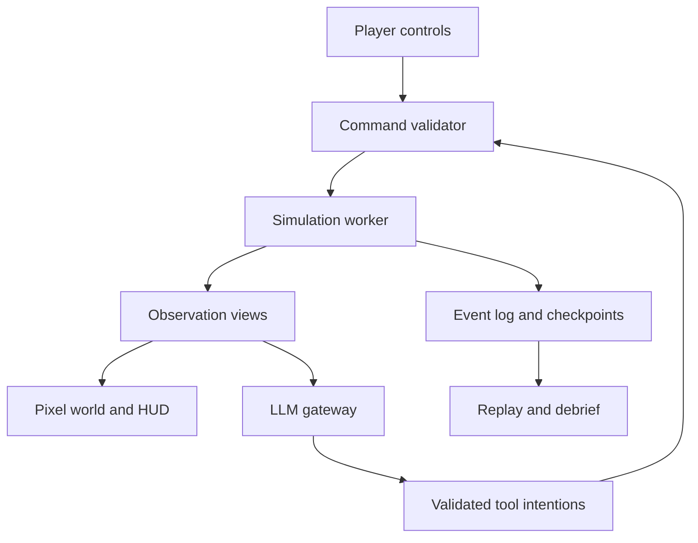

# SIM-01 specification excerpt

Read AGENTS.md and frozen src/shared and src/workers/protocol.ts contracts. Copied from the supplied master plan, which remains authoritative.

## Global constraints

- The confirmed art direction is **flat, overhead 2D with large, visible pixels**. The proposed implementation starts with a 16 × 16 tile grid and a 320 × 192 logical world viewport; verify readability with actual native-size assets. Earlier isometric concepts and their asset dimensions are superseded.
- The simulation owns physical state, task completion, timing, and scores. An LLM cannot assign temperatures, restore equipment, invent spare resources, or award points.
- Every consequential action has prerequisites, a duration, an equipment target, resource requirements, and explicit results.
- Truth, player observations, and each coworker's knowledge remain separate.
- Every shipped scenario has a known feasible response under its declared objectives. Damage-limitation scenarios must say that complete service preservation is impossible.
- The core mission remains playable when the model endpoint is slow, unavailable, or returns invalid output.
- API keys remain on the server. The first release has no live facility connections.
- Use high-level fictional maintenance actions. This is an educational systems model with disclosed assumptions; facility-calibrated prediction is a later capability.
- Prefer one complete, explainable incident over adding unfinished systems before the release gates pass.
- Run one coordinator and at most three workers. Assign exclusive writable paths, a pinned base commit, explicit contracts, and a concrete acceptance gate before dispatch. The coordinator owns integration and shared files.
- The public repository contains source, documentation, provenance, and synthetic fixtures. Credentials and local run data stay outside commits. A public repository does not require a publicly hosted game.

## Review focus

Review the units and accounting in the thermal and electrical models; algebraic dependencies between available power and cooling; simultaneous-event ordering; observations that could reveal hidden faults; delayed model responses after a reset; whether alternative replays preserve the same external disturbances; and whether low-resolution sprites remain recognizable at their actual runtime size.

## 2. The first complete mission

### 2.1 Facility

Build one compact site with eight racks in three labeled bays inside one hall. Add two aggregate cooling trains, two UPS units and distribution paths, a generator-backed cooling branch, two technicians, and a remote IT operator. The map can represent the generator as a connected yard panel if it does not fit the initial room.

The three bays are organizational and visual groupings. They are not three independent engineered data halls. Cooling allocation, airflow paths, and shared dependencies are explicit configuration data.

### 2.2 Flagship incident: Hot Restart

A short power disturbance ends. The racks remain powered through their UPS paths, but cooling fails to resume because a declared controller or circulation prerequisite is unavailable. Inlet-proxy temperatures rise, while the electricity dashboard appears mostly recovered.

The player can inspect the cooling state, dispatch a technician, reduce noncritical workload, check a second temperature source, and stage the eventual recovery. Repeatedly issuing restart commands does not bypass a missing prerequisite. A completed repair does not instantly remove stored heat.

Hot Restart must place critical, interactive, and deferrable work together on each endangered rack. Pausing unrelated batch racks does not reduce a critical rack's heat when the thermal nodes have no coupling and cooling is unavailable. The dedicated batch-rack placement in Last Feed is a separate scenario configuration. Validate the first mission's mitigation claim against its exact workload placement.

The first recovery lesson is verification before restoring workload. The current identical cooling trains and common capacity pool do not establish a meaningful load-aware chiller restoration order. A later scenario must add explicitly different loads or staggered readiness before claiming to teach that decision.

The opening mission uses a simple control or circulation fault. A water-temperature restart lockout belongs in a later scenario with an explicit water-loop state; the first model must not claim to simulate that mechanism using only room temperature.

### 2.3 Eight to twelve minutes of play

| Phase | Experience | What it teaches |
|---|---|---|
| Briefing, about 45 seconds | See the service objective, two crew members, and current equipment status. | Understand priorities before acting. |
| Initial disturbance, about 1 minute | Power returns but cooling output remains low. | Power availability and equipment readiness are different. |
| Diagnosis, about 2 minutes | Inspect trends and ask a coworker to check a prerequisite. | Separate evidence, inference, and missing information. |
| Intervention, about 3 minutes | Dispatch repair and choose a workload mitigation. | Repair time and thermal headroom create a real tradeoff. |
| Recovery, about 2 minutes | Restore cooling and manage a declared workload pulse. | Recovery needs sequencing and verification. |
| Debrief, about 2 minutes | Review the event chain and a simulated alternative. | Connect the decision to an operational principle. |

These are pacing targets. Default playback is 1× simulation speed. Offer pause and explicit 2× or 4× controls; display simulation time separately from wall time. The short judging demonstration can use a prepared checkpoint and faster playback.

### 2.4 Interaction loop

Select an asset, inspect its readings and timestamps, choose an intervention, select an eligible technician if required, review travel and work time, then dispatch. Show queued, traveling, inspecting, working, blocked, completed, and canceled states. A worker begins physical work only after arrival at the equipment's service tile.

Remote workload changes and field maintenance are different task types. A remote cap can take effect after its configured control delay; a physical repair consumes a technician and travel time. A canceled repair records any completed work and releases the worker according to that task's explicit cancellation rule.

### 2.5 Objectives and mission ending

Define the first mission's success in scenario data: the failed cooling prerequisite is restored; critical demand is fully served; no active overload remains; every modeled inlet proxy is below the profile's 27°C warning threshold; and batch processing has resumed at a sustainable rate. Hold those conditions for 60 simulated seconds and require a final fresh verification report before declaring success. The debrief still reports any earlier service loss and remaining batch delay.

Proposed failure conditions are 60 consecutive simulated seconds with no critical service, or failure to stabilize within a 600-second mission window. These are authored exercise limits, not real operational standards. Ending a mission stops new gameplay actions and closes pending model requests. Provide a clear result, debrief, retry, and checkpoint-retry path. Any continued practice occurs in an explicitly resumed practice branch.

The mandatory tutorial explains the first selection, timestamp check, inspection, and dispatch through short contextual prompts. Display objective progress throughout the mission. This authored first-time flow ships even if the adaptive LLM coach is cut.

Internal success evaluation can inspect truth, but live objective checkmarks and recovery countdowns must wait for permitted evidence. Show "awaiting verification" instead of disclosing a hidden correction. The initial verification rule uses authorized readings taken within 10 simulated seconds, with an independent probe required when the ordinary sensor is under investigation. Define separate objectives for the other families; Hot Restart's cooling-repair requirement does not apply to a sensor-only incident.


## 3. What realism means

Blackout has two initial fidelity levels: authored incident logic and reduced-order physical models. It models capacity, energy, heat accumulation, dependencies, delays, and information quality consistently. It does not initially calculate three-dimensional airflow, detailed battery chemistry, electrical waveforms, protective-device coordination, humidity, condensation, or real failure probabilities.

The distinction between a plausible model and a calibrated prediction must remain visible in the technical notes. Published thermal research uses lumped models alongside measured or CFD-derived information; those calibration inputs are absent from a hackathon prototype. [S4]

The player-facing interface should explain a relevant assumption when it affects a decision, such as "Estimated UPS runtime at current observed load." Keep the full assumptions in an accessible model-information panel and the debrief.

### 3.1 Authoritative clock and event order

Use a fixed step of **one simulated second**. Rendering and model requests do not advance the clock. Faster playback runs more of the same fixed steps; it does not enlarge the integration step.

Order scheduled events by simulation time, phase priority, then stable sequence number. At a tick boundary:

1. Apply due external disturbances and complete scheduled tasks in the documented order.
2. Validate queued player and NPC commands against the resulting state; reserve resources for accepted tasks.
3. Resolve electrical connectivity, source limits, transfer states, and equipment readiness.
4. Allocate served IT load and cooling electrical demand with explicit priorities and capacity limits.
5. Integrate battery energy and thermal state for the interval.
6. Apply resulting equipment protection transitions and recompute affected service status.
7. Sample sensors, deliver messages, update alarms, and publish actor-specific views.

Document which transitions take effect at the next boundary. If an energy source empties inside a tick, split or account for the partial powered interval; never grant a full extra second of energy. Use finite bounded resolution for capacity interactions rather than an unbounded solver loop.

Pause on browser visibility loss by default. On return, do not fast-forward through wall-clock time that was never simulated. Persist the checkpoint and event log before an intentional pause or reset where practical.

### 3.2 Thermal behavior

Give each rack-associated zone an effective temperature state. It is an **inlet-temperature proxy**, not a CFD prediction of every location in the room.

```text
C_i × dT_i/dt = Q_IT,i + Q_other,i
                 + sum(G_ij × (T_j - T_i)) - q_cool,i

q_cool,i = min(q_allocated,i, K_i × max(0, T_i - T_supply))
sum(q_allocated,i) <= available thermal cooling capacity
```

Use °C for temperature, kJ/K for effective heat capacity, kW for heat flow, kW/K for conductance, and seconds for time. Symmetric exchange between two zones must cancel in the combined energy balance.

The first cooling model uses a fixed 20°C cooling reference while the cooling train is ready. It does not calculate an actual supply-air temperature. When a required pump, controller, airflow path, or electrical supply is unavailable, that train's available output changes according to its modeled state. A later water-loop model can add finite coolant storage and temperature-dependent restart limits.

Cooling allocation uses declared zone connections. For the initial common-space model, calculate each zone's request `d_i = K_i × max(0, T_i - 20)`, then allocate `q_i = d_i × min(1, Q_available / sum(d))`. Set every `q_i` to zero when the request sum is zero. Do not let each rack independently claim the entire cooling unit's capacity. Passive building-envelope heat exchange is omitted from the short initial mission and must be disclosed in the model notes.

### 3.3 Demonstration parameters

The following constitute a fictional training profile selected for clear, testable behavior.

| Parameter | Initial value | Meaning |
|---|---:|---|
| Racks | 8 | Eight thermal zones and workload hosts. |
| Idle / peak rack power | 2 / 12 kW | Linear approximation within the ready state. |
| Baseline utilization | 0.6 | Gives 8 kW per rack and 64 kW total IT load. |
| Effective zone heat capacity | 200 kJ/K | Represents thermal inertia omitted from the simple model. |
| Cooling conductance per zone | 2 kW/K | Heat removal depends on the temperature difference. |
| Cooling reference temperature | 20°C | A model boundary, not a calculated supply-air measurement. |
| Initial neighbor conductance | 0 kW/K | Keep the first reference cases uncoupled; recalculate expected values before adding coupling. |
| Cooling trains | 2 × 80 kW thermal | Aggregate heat-removal capacities. |
| Simplified cooling COP | 3 | Thermal output divided by electrical input, before configured auxiliary demand. |
| UPS units | 2 × 5 kWh available stored DC energy | Energy above the modeled cutoff; each also has an independent 80 kW AC output limit. |
| Battery discharge efficiency | 0.95 | An illustrative conversion efficiency. |
| Generator capacity | 200 kW | Must cover all connected demand, including cooling and charging. |
| Generator start / transfer | 20 / 5 seconds | Authored delays, not specifications of real equipment. |
| Sensor interval | 5 simulated seconds | Separate from render and UI update frequency. |
| Normal sensor noise | Bounded ±0.2°C | Seeded observation variation. |

At baseline, one uncapped zone equilibrates at 20 + 8/2 = **24°C**. With all cooling removed, its initial temperature rise is 8/200 = **0.04°C per second**, or **3°C in 75 seconds**, before other modeled effects. Its uncapped cooling time constant is C/K = **100 seconds**. One 80 kW train can cover the 64 kW baseline heat load, but cannot cover an assumed 96 kW peak by itself.

These arithmetic checks are reference cases for the engine. They do not validate the chosen parameters against a real facility.

ASHRAE's recommended temperature envelope for classes A1–A4 is measured at the equipment inlet. Its 18–27°C recommendation is not a universal instantaneous shutdown threshold. [S3] Store warning, throttling, trip, dwell, hysteresis, and restart settings in a clearly labeled fictional equipment profile. A proposed gameplay profile can warn above 27°C, throttle after sustained exposure above 32°C, and shut down after sustained exposure above 40°C; these are game rules requiring tuning, not manufacturer limits.

Throttle reduces useful compute and changes power demand. Shutdown reduces heat production but does not reset the zone temperature. Restart requires both acceptable conditions and a boot delay.

Freeze the following first protection profile for integration tests, then tune only through a versioned scenario/profile change. These are fictional rules, not manufacturer specifications.

| State or transition | Initial rule |
|---|---|
| Ready | 100 normalized compute units per second; power follows executed work. |
| Monitoring warning | A reported temperature above 27°C creates an observed alarm. |
| Thermal throttle | True inlet proxy at or above 32°C for 30 continuous seconds reduces useful capacity to 50 units per second. |
| Throttle release | True inlet proxy at or below 30°C for 30 continuous seconds. |
| Thermal shutdown | True inlet proxy at or above 40°C for 10 continuous seconds; latch off. |
| Thermal restart | At or below 30°C for 30 seconds, valid power, and an accepted reset. |
| Off | Zero useful compute and zero rack power in this initial model. |
| Booting | 20 seconds at 4 kW with no useful compute, then the applicable ready or throttled state. |
| UPS output overload | Requested AC output above 80 kW trips that output at capacity resolution, with no unspecified overload allowance. |
| UPS reset | Qualified reset, healthy input, cleared fault, and declared post-boot demand at most 76 kW on the affected surviving path. |

Thermal protection uses the true proxy as an approximation of a separate protective measurement. A faulty monitoring sensor cannot directly trip a physically cool rack. When hosts are off, a declared out-of-band controller can store startup admission limits; it cannot execute workloads until hosts are powered and ready. This provides an explicit recovery path after overload rather than requiring powered hosts to lower the very demand that prevents their restart.

### 3.4 Power and stored energy

Use a capacity-and-connectivity graph for utility, generator, transfer switch, distribution branches, UPS units, rack inputs, and cooling supplies. A/B inputs only provide the redundancy supported by their actual graph. Declare shared upstream components explicitly.

```text
E_next = clamp(E + (eta_charge × P_charge
                    - P_discharge / eta_discharge) × dt / 3600,
               0, E_max)
```

Energy is in kWh; power is in kW. Charging and discharging are mutually exclusive. Power rating and stored energy are separate constraints. The 5 kWh figure is stored DC energy before discharge conversion losses, not usable AC output energy. This avoids counting the efficiency penalty twice.

At 32 kW per UPS, 5 kWh of stored DC energy and 95% efficiency give an ideal runtime of about **8.91 minutes**. A single UPS supporting 64 kW at that same initial energy gives about **4.45 minutes**. These figures apply while battery power is actually required. A failure of one UPS output while the other UPS still has utility input does not make the surviving UPS discharge its battery. The interface must revise the estimate when load changes and label it as a model estimate. Actual UPS runtime prediction needs device-specific information and calibration. [S5]

Cooling electrical demand is separate from thermal output. At the proposed COP, removing 60 kW of heat requires 20 kW of modeled cooling electricity before auxiliary loads. Count that demand against the actual cooling supply, not against the rack UPS unless the topology explicitly connects it there.

For the first mission, the topology is utility or generator to the ATS board, then separate branches to UPS inputs and cooling. UPS outputs supply IT only. The shared pump/controller belongs to the cooling branch. This permits powered racks and falling cooling output at the same time.

Use a proposed 2 kW standby allowance per enabled cooling train, including its allocated auxiliary demand, and 95% UPS conversion efficiency. The baseline source demand is about 67.4 kW for UPS inputs plus 25.3 kW for cooling, or 92.7 kW before charging. Cap recharge at 5 kW input per UPS. Do not add conversion losses to rack heat unless those losses physically belong in the modeled zone.

Resolve upstream allocation in a fixed order: IT conversion first, cooling second, charging last. Reserve cooling standby consumption, then bound thermal capacity by `COP × max(0, cooling_electrical_budget - standby_demand)`. Calculate heat removal using temperatures at the beginning of the segment. This removes a circular dependency between cooling demand and available power without an iterative algebraic solver.

An authored healthy sequence can start the generator by 20 seconds, finish transfer by 25 seconds, and finish a 30-second cooling restart at 55 seconds. At baseline, 55 seconds without cooling raises the modeled temperature from 24°C to 26.2°C. The flagship fault extends this ordinary delay. Show the difference between expected restart time and a failed prerequisite.

When a battery will empty within a tick, compute `t_empty = 3600 × eta_discharge × E / P_discharge`, integrate to that boundary, change the topology, recompute feed sharing, and integrate the remainder. A surviving UPS can empty sooner after receiving the other path's load, so recalculate its boundary after a feed loss.

Do not model every power shortage as graceful proportional supply. Equipment profiles define overload delay, trip, priority shedding, and restart behavior. Stage later boot loads so recovery can expose real capacity constraints.

### 3.5 Workloads and services

Approximate ready-state IT power as `P_idle + utilization × (P_peak - P_idle)`, with utilization bounded from zero to one. Use separate profiles for off, booting, throttled, and ready states.

Workload migration consumes time and declared network capacity. Destination demand and heat increase. Queue depth, dropped demand, delayed batch work, and useful delivered service remain separate quantities. Do not equate "all racks powered" with "all services healthy."

For the initial service model, one ready rack has 100 normalized compute units of capacity per simulated second. These are game units, not benchmarked hardware throughput. In Hot Restart, each rack initially receives 20 critical, 10 interactive, and 30 batch units per second, for utilization 0.6 and 8 kW. A deterministic scheduler serves critical work first, interactive work second, and batch work last. Pausing batch leaves 30 units per second and 5 kW while creating a batch backlog. Offered demand remains independent of admission caps, so reducing the cap cannot manufacture a perfect service-delivery score.

Conserve batch work as `next_backlog = previous_backlog + arrivals - completions - explicitly_logged_cancellations`. Instantaneous critical and interactive shortfall is recorded separately. Catch-up work after recovery consumes real spare capacity and can raise heat. Workload migration is outside the first release; pause, resume, and cap controls are sufficient for Hot Restart and the listed early extensions.

The initial action catalog has no batch-cancellation action, so the cancellation term is zero. In Hot Restart, resume batch with an initial catch-up ceiling of 50 units per second per rack. Together with 20 critical and 10 interactive units, that gives 80 executed units, 10 kW, and backlog drainage of 20 units per second per rack while capacity permits. The scheduler and protection limits still apply.

The first release can use service capacity and host availability. The next phase adds an explicit service dependency graph, network partitions, boot sequencing, and a three-replica database requiring two reachable replicas for writes. That quorum is the game's declared architecture, not a general rule for all databases.

### 3.6 People and tasks

Two field technicians have role qualifications, position, travel speed, a current task, and availability. The remote IT operator can handle workload tasks. Each worker has one active task. Shared task resources, such as a diagnostic tool, are explicit if used in a scenario.

Use the tile grid for navigation and a declared meter-per-tile scale for travel time. Personnel cannot walk through racks or repair from across the room. A path becoming blocked produces a visible blocked task or a deterministic reroute.

Start with one meter per tile and 1.25 meters per simulated second of walking speed. The task durations below are additional to travel and are authored pacing assumptions.

| Action | Actor | Work duration | Effect |
|---|---|---:|---|
| Inspect asset or take independent reading | Qualified field technician | 30 s | Produce a timestamped scoped observation. |
| Pause batch or change its ceiling | Remote IT operator | 3 s | Change admission while retaining backlog. |
| Restore cooling-control prerequisite | Facilities technician | 120 s | Requires inspection, clears the declared fault, then starts the 30 s cooling restart. |
| Clear airflow obstruction | Facilities technician | 60 s | Restore conductance without resetting temperature. |
| Replace monitoring probe | Facilities technician | 60 s | Restore reporting without changing physical temperature. |
| Reset tripped UPS output | Electrical technician | 20 s | Apply the reset conditions and downstream boot sequence. |
| Verify recovery | Remote IT operator | 10 s | Produce a report from current permitted readings and task results. |

Canceling an unfinished physical task releases the worker and produces no completed repair effect. Restarting the task requires its full work duration. Already completed observations remain available. This initial rule deliberately omits partial repair progress.

## 4. Observations, uncertainty, and communication

Maintain three layers:

| Layer | Contains | Who can use it |
|---|---|---|
| World truth | Actual energy, heat, connectivity, latent faults, pending failures, and equipment readiness. | Engine and post-mission forensic analysis. |
| Player observation view | Sensor samples, timestamps, delivered reports, visible indicators, and permitted topology. | HUD, world presentation, player-facing coach. |
| Actor knowledge view | Only observations and reports available to that coworker. | That coworker's model prompt and tools. |

Every observation has an ID, source, value, units, observation time, receipt time, and known freshness or quality metadata. Do not automatically mark a covertly faulty sensor as faulty. The player may need to compare it with an independent source.

The art also consumes an observation-based presentation view. A hidden fault must not appear as a red cabinet simply because the engine knows about it. A stopped, visible fan can be an observation. An invisible internal control failure cannot. The thermal overlay displays measured or explicitly estimated values; unknown cells remain unknown and stale readings are marked.

Handoffs contain affected assets, current status, supporting observations and their times, actions completed, work in progress, unresolved risks, next owner, and acknowledgment. The communication score concerns correct information and delivery, not eloquence or message count. HSE's handover guidance supports preparation, communication, and incoming cross-checking as distinct parts of the process. [S6]


## 10. Architecture and contracts

Phaser owns the scene, camera, sprite animation, input hit areas, and technician presentation. React owns the HUD, charts, equipment list, accessible controls, conversations, and debrief. The official React TypeScript template provides a React–Phaser bridge and currently identifies Phaser 4 in its README; its older repository description still says Phaser 3. Pin the actual compatible dependency set at kickoff. [S10]



The local service exposes a small bounded OpenAI endpoint and serves the production client from the same origin. No vector database, account system, multiplayer server, cloud host, or live equipment connector is needed in the first release. Store local runs in IndexedDB and allow JSON export. Use static, versioned procedure excerpts keyed by asset and task before adding retrieval infrastructure.

### 10.1 Shared data boundaries

| Contract | Key fields | Owner |
|---|---|---|
| `ScenarioSpec` | Versions, template, seed, topology, equipment profile, external events, fault presets, objectives. | Content validator. |
| `TruthState` | Run, revision, simulation time, physical state, tasks, latent faults. | Engine only. |
| `Observation` | ID, source, value, units, observed and received times, known quality. | Observation system. |
| `KnowledgeView` | Actor, accessible observations, delivered messages, allowed procedures, view hash. | Projection layer. |
| `ActionIntent` | Actor, domain action, stable target, bounded args, intended simulation time; independent of transport IDs. | Recorded command stream and branch replay. |
| `ActionRequest` | Request/run IDs, action intent, relevant expected versions, idempotency key. | Validated command path. |
| `PublicToolResult` | Status, public reason code, allowed evidence, task receipt/ETA, matching call and actor IDs. | Role-scoped projection; internal diagnostics excluded. |
| `SimEvent` | ID, time, type, affected entities, causal parents, visibility, payload. | Append-only event log. |
| `AgentResponse` | Request/run IDs, speaker, observed versions, factual field references, labeled inference, tool intentions. | Gateway plus validators. |
| `Checkpoint` | Physical state, tasks/travel, reservations, events, delayed deliveries, knowledge, protection timers, draw state. | Engine snapshot/restore. |
| `RunRecord` | Engine/schema/scenario/procedure identities, model/prompt provenance, seed, external schedule, inputs, events, dialogue, checkpoints. | Persistence. |

Expose a small engine API: `initialize`, `step`, `applyCommand`, `observe`, `snapshot`, and `restore`. The engine imports no React, Phaser, DOM, network, or provider code. It receives deterministic randomness and scenario data through explicit inputs.

### 10.2 Proposed repository layout

These paths are the intended layout for a new repository; they do not describe files already implemented.

```text
src/shared/           contracts.ts, schemas.ts, units.ts, fixtures.ts
src/sim/              engine.ts, clock.ts, events.ts, rng.ts
src/sim/systems/      power.ts, thermal.ts, workload.ts, crew.ts, observations.ts
src/sim/replay/       recorder.ts, checkpoints.ts, ledger.ts, comparison.ts
src/workers/          simulation.worker.ts, protocol.ts
src/game/             FacilityScene.ts, sprites.ts, paths.ts, overlays.ts
src/ui/               hud/, inspector/, crew/, radio/, debrief/
src/llm/              client.ts, tool-runner.ts, fallback.ts
src/content/          equipment/, topologies/, scenarios/, procedures/
src/persistence/      runs.ts
server/               index.ts, config.ts, llm/adapter.ts, llm/prompts.ts, llm/validation.ts, llm/budget.ts
public/assets/        world.png, world.json, portraits.png, manifest.json
tests/contracts/      shared fixture and protocol compatibility
tests/sim/            reference cases and scenario policies
tests/llm/            invalid, stale, and knowledge-boundary cases
tests/replay/         checkpoint, replay, and comparison cases
tests/e2e/            mission.spec.ts, fallback.spec.ts
docs/                 blackout-master-plan.md, build-status.md, task-packet-template.md,
                      asset-provenance.md, model-assumptions.md, demo-script.md, handoffs/, reviews/
AGENTS.md             short development-agent execution guide
.env.example          nonsecret local configuration defaults
```

### 10.3 Frozen integration surface

The coordinator owns contract version `1` and publishes the types, Zod runtime schemas, JSON examples, and adapter stubs before workers start. Interfaces below are the required public boundaries; implementation internals remain owned by their worker. Use stable string IDs and finite serialized numbers, explicit units, and simulation seconds. Wall-clock milliseconds belong only in transport/latency fields.

| Boundary | Required interface | Behavioral contract |
|---|---|---|
| Engine creation | `initialize(spec: ScenarioSpec, runId: string): SimulationEngine` | Creates a balanced, seeded state; performs no network or rendering work. |
| Fixed advancement | `engine.step(ticks: number): StepResult` | Advances an integer number of one-second ticks using the same event order at every playback speed. |
| Commands | `engine.applyCommand(request: ActionRequest): CommandReceipt` | Queues intent with a stable sequence and idempotency key; distinguishes queued from accepted/rejected/applied. Execution is resolved at the documented command boundary. |
| Projection | `engine.observe(actorId: string): KnowledgeView` | Returns permitted evidence, public task receipts, action affordances, and observed versions; excludes latent faults and hidden causal parents. |
| Checkpoint | `engine.snapshot(): Checkpoint` and `restore(checkpoint: Checkpoint, runId: string): SimulationEngine` | Restores all authoritative timers, pending work, knowledge, and RNG/event state; a new run envelope invalidates old provider callbacks. |
| Browser bridge | `SimulationClient.command`, `observe`, `subscribe`, `pause`, `setSpeed`, `snapshot`, `restore` | Typed request IDs and a single worker protocol; UI never reaches into worker memory. |
| UI root | `OperationalView({ view, onAction, onInspect, onAskCoworker })` | Reads one projected view and emits typed intentions. Visual state is not authoritative simulation state. |
| Gateway client | `startInteraction(input, signal)` and `continueInteraction(input, signal)` | Returns a discriminated union: scoped tool request, validated final response, or explicit fallback. |
| Tool runner | `executeToolIntent(intent, scopedContext): Promise<PublicToolResult>` | Uses the same worker validation path and role projection as direct player actions. |
| Outcomes | `buildOutcomeLedger(record): OutcomeLedger` | Computes numerical outcomes and factual timeline from the engine record; makes no model call. |
| Comparison | `compareEarlierCap(record, change): ComparisonResult` | Uses the recorded external schedule; returns completed or unsupported continuation with the valid common horizon. |

The engine may receive commands while paused, but processing them must not advance physical time. At an explicit command boundary, reserve accepted work and return its receipt; travel, work duration, and heat resume only when time advances. Record that boundary's sequence so replay does not depend on Promise timing. A queued receipt is never presented as a completed inspection or accepted repair before the relevant validation occurs.

Freeze these minimum payloads in the schema pack:

| Payload | Fields required before fan-out |
|---|---|
| `KnowledgeView` | `schemaVersion`, `runId`, `actorId`, `simTime`, `viewHash`, permitted observations, known topology, public task summaries, allowed procedure IDs, action affordances, observed entity versions. |
| `ActionRequest` | `schemaVersion`, `runId`, `requestId`, `actorId`, `intent`, `expectedEntityVersions`, `idempotencyKey`. The worker assigns its simulation sequence. |
| `CommandReceipt` | Matching IDs, status, public reason code, permitted task ID/ETA or evidence references, and applicable observation time. Hidden diagnostics stay internal. |
| `GatewayStart` | Run/request/actor IDs, role, bounded user message or trigger, scoped `KnowledgeView`, permitted procedure excerpts, prompt version. |
| `GatewayContinue` | Matching run/request/interaction/actor IDs, expected call ID, current scoped view, validated public tool result. Provider history stays bounded and server-owned. |
| `AgentResponse` | Matching IDs, speaker, factual field selectors, clearly labeled inference/uncertainty, permitted action proposals, and mode (`live`, `scripted`, or `recorded`). |
| `OutcomeLedger` | Record/version identity, equal-horizon times, critical/interactive delivery and shortfall, batch backlog/delay, thermal and protection events, action/evidence timeline. |
| `ComparisonResult` | Base/branch identity, continuation policy, shared external-schedule identity, completion/unsupported status, supported horizon, outcome ledgers when valid, and public explanation of limitations. |

Freeze the worker request/reply discriminated unions as part of G0, not merely the names of domain types. Requests cover `initialize`, `advance`, `command`, `observe`, `snapshot`, and `restore`; replies cover initialized/advanced acknowledgments, command receipts, projected views, recorder-only checkpoints, and bounded errors. Every request/reply carries its correlation ID and run identity, with the explicit new-run identity on restore. The coordinator's protocol fixtures cover each variant, including stale-run rejection.

Freeze gateway responses with a `kind` discriminator for `tool_request`, `final`, and `fallback`, separate from the displayed `live`/`scripted`/`recorded` mode. The UI props and typed intent callbacks in this section are part of the same contract version. No worker supplies an alternate envelope to avoid an integration dependency.

A checkpoint can contain authoritative state for restoration, but it is restricted to the recorder/replay path. Do not pass it through normal React view props or the coworker gateway. `ComparisonResult` must distinguish `complete` from `unsupported`; the unsupported variant includes the first invalid retained action and valid-prefix evidence, and excludes full-horizon alternative metrics. A UI must not render an unsupported branch as a completed comparison.

The gateway can reject malformed or excessive payloads, but it does not become a second source of physical truth. A local-browser training game does not claim server-verified anti-cheat. Distinguish API response shape validation from the engine's domain validation and the UI's evidence rendering.

`GET /api/health` reports mode, configured model, and whether a key is configured, without revealing the key or making a paid probe. `POST /api/llm/turn` accepts the start/continuation union. Abort/reset closes the matching interaction, and any delayed reply must still fail the run/request check. Keep the first protocol ordinary JSON over local HTTP; streaming and WebSockets are not required.


**Files:** `src/sim/*`, `src/sim/systems/power.ts`, `thermal.ts`, `workload.ts`, `tests/sim/*`.

**Owner and dependency:** Simulation worker, `SIM-01`, after G0. Deliver reference cases as a small first commit before adding the whole mission lifecycle.

- [ ] Implement stable event ordering and fixed-step advancement.
- [ ] Implement power connectivity, capacity, UPS energy, and readiness states.
- [ ] Implement heat balance, bounded cooling allocation, workload power, and protection dwell/hysteresis.
- [ ] Implement the fictional equipment profile and an initial balanced state.
- [ ] Verify the analytic equilibrium, cooling-loss slope, recovery curve, UPS runtime, and capacity bounds.
- [ ] Compare a ten-minute reference trace with a half-sized timestep; choose a documented tolerance, initially 0.1°C for the thermal trace.

**Gate:** The headless reference cases pass before any animation is treated as evidence of correctness.

